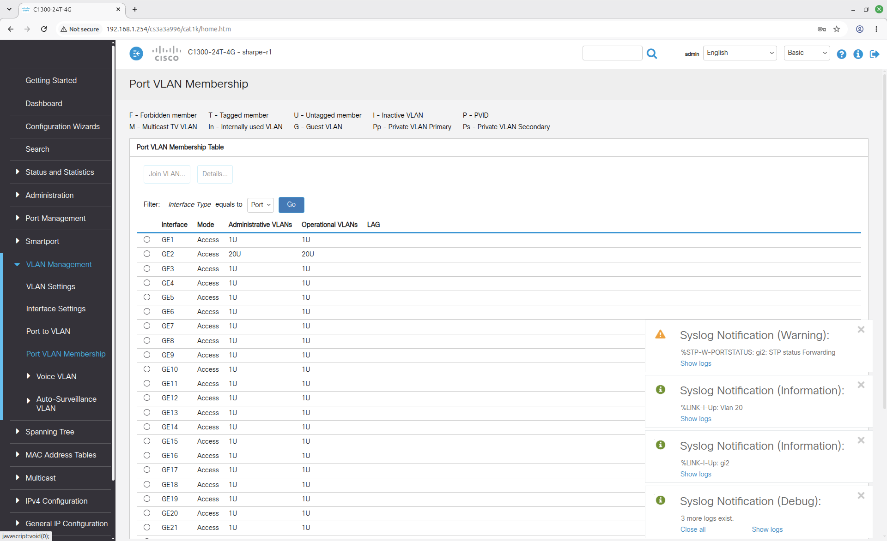
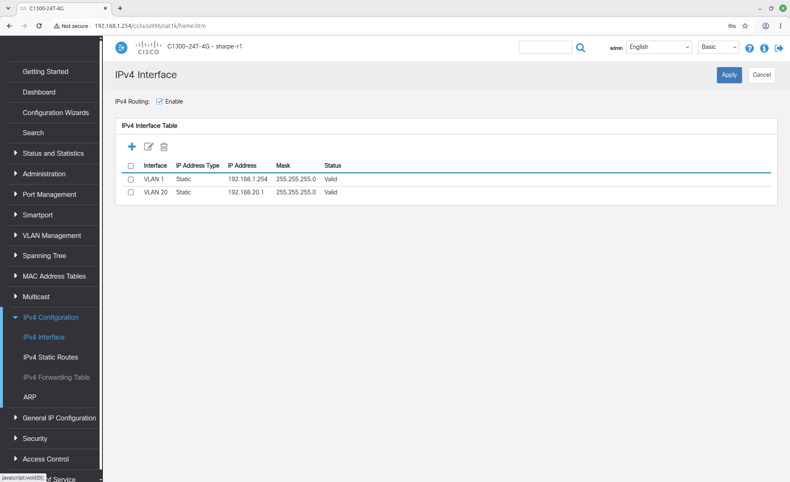

# Cisco Catalyst 1300 Lab 2 — VLANs and Inter-VLAN Routing

> **Before you start:** Download the [submission template](https://raw.githubusercontent.com/WikiSteve/networking-labs/refs/heads/main/labs/012-catalyst-1300-vlan-routing/Catalyst%201300%20Lab%202%20SUBMISSION%20TEMPLATE.pptx). Add each required screenshot as you complete the lab, then submit the completed template for grading.

[Download the interactive HTML lab](./index.html) · On the file page, click **Download raw file**, then open the saved HTML in your browser. Save the PowerPoint beside it if you want the template available offline.

Complete [Catalyst 1300 Lab 1](../011-catalyst-1300-initial-configuration/README.md). Verify that you can open your switch at `http://192.168.1.254` and connect to it using PuTTY over SSH. Keep your switch isolated from the classroom network and other groups. Use two lab PCs or Windows VMs with separate wired connections to your switch.

A **VLAN** groups switch ports into a **broadcast domain**. A switch forwards a broadcast only within that VLAN. In this lab, use ARP to see that boundary. Then give each VLAN a different subnet and use the switch to route IP packets between them.

| Device | Switch port in the example | Starting IPv4 address |
|---|---|---|
| PC A and switch management | GE4 (Gi4 in the CLI) | 192.168.1.10/24 |
| PC B | GE2 (Gi2 in the CLI) | 192.168.1.20/24 |
| Switch VLAN 1 | Existing management interface | 192.168.1.254/24 |

Record your actual ports. Substitute your PC B port wherever the example uses GE2 or Gi2. Keep PC A's port in VLAN 1 throughout. The examples use `255.255.255.0` for every subnet mask.

## 1. Set up Windows and observe the first broadcast

Predict whether PC B will see the broadcast. Then look for the request and reply in your own capture.

On each Windows lab PC, open **Network Connections** by pressing **Windows+R**, typing `ncpa.cpl`, and pressing **Enter**. Right-click the wired lab adapter, choose **Properties**, select **Internet Protocol Version 4 (TCP/IPv4)**, and open **Properties**. Choose **Use the following IP address**. Enter the starting address and subnet mask from the table. Leave the default gateway and DNS blank. Make sure the lab PC has no other active network path to these subnets. If you use VMs, bridge each VM's lab adapter to its own physical Ethernet port.

Open Wireshark on PC B and start a capture on its wired lab adapter. Enter `arp or icmp` in the display filter. On PC A, run `ping 192.168.1.20`. If ARP is already cached, open Command Prompt as administrator and run `arp -d 192.168.1.20` before pinging again. This removes PC B's address from PC A's ARP cache so PC A has to ask again.

## **Screenshot 1: ARP in the Same VLAN**

**Requirement:** Show PC B's Wireshark capture with PC A's ARP request for `192.168.1.20`, the broadcast destination `ff:ff:ff:ff:ff:ff`, and PC B's ARP reply.

## 2. Move PC B to VLAN 20

**Optional Cisco video:** [Cisco Tech Talk — Configuration Wizards](https://www.youtube.com/watch?v=C3phe1BB04k). Optional background. Cisco demonstrates the VLAN wizard. Carry out the manual steps below for this lab.

1. In the switch GUI, open **VLAN Management > VLAN Settings**. Click **Add (+)**, create VLAN **20**, and click **Apply**.
2. Open **VLAN Management > Interface Settings**. Select PC B's port, click **Edit**, and set **Interface VLAN Mode** to **Access**. Keep the port in Layer 2 mode if the GUI shows a switchport mode choice. Apply the setting.
3. Open **VLAN Management > Port VLAN Membership**. Select PC B's port and click **Join VLAN**. Under **Access Mode Membership (Active)**, set **Access VLAN ID** to **20** and click **Apply**. An access port sends frames untagged and assigns incoming untagged frames to its access VLAN. Verify that PC B shows `20U` and PC A still shows `1U`. If your firmware puts membership under **Port to VLAN**, select VLAN 20, click **Go**, set only PC B's port to **Untagged**, and verify its PVID and membership before continuing.



Keep both IP addresses unchanged. Predict whether PC B still sees the ARP request. Compare your prediction with the two captures.

Start fresh Wireshark captures on both PCs with `arp or icmp`. On PC A, clear the same ARP entry and ping `192.168.1.20` again. Leave both captures running through the same ping attempt, then stop them. If the PCs are on separate screens, save both captures and open them in two Wireshark windows on one PC for your screenshot.

## **Screenshot 2: ARP Stops at the VLAN Boundary**

**Requirement:** In one screenshot, show the two Wireshark captures side by side, with PC A's fresh ARP requests for `192.168.1.20` visible and no matching request in PC B's capture.

Temporarily return PC B's port to VLAN 1 as its untagged membership and PVID. Wait for the port to forward traffic, clear PC A's cached entry, and ping again. Verify that PC B sees the request and ping works. Then move PC B's port back to VLAN 20 before starting the next section.

## 3. Configure the switch to route between the VLANs

**Optional Cisco video:** [Cisco Tech Talk — Layer 3 Switching on Catalyst 1300](https://www.youtube.com/watch?v=GXuDvDIRTXA). Watch for the VLAN interfaces and IPv4 routing. Use the IP addresses in this lab when you configure your switch.

1. Open **IPv4 Configuration > IPv4 Interface**. **Before adding another interface**, make VLAN 1's existing management address a static `192.168.1.254` with mask `255.255.255.0`. If the current row says **Default** or **DHCP**, use **Add (+)**, choose **VLAN 1** and **Static**, enter the same address and mask, and apply. Accept the warning about replacing the DHCP address if shown. Reopen the same management URL if needed and verify the VLAN 1 row says **Static** and **Valid**. Adding another static interface while relying on the factory-default address can make the original address stop responding.
2. On the same page, click **Add (+)**. Choose **VLAN 20**, then **Static**. Enter `192.168.20.1` and `255.255.255.0`. Click **Apply**.
3. Check **Enable** next to **IPv4 Routing** and click **Apply**. If it is already checked, leave it enabled.
4. Change PC B's Windows address to `192.168.20.20` with mask `255.255.255.0`. Keep PC A at `192.168.1.10`. Leave both PC gateways blank for the first test. From each PC, ping its own local switch address to verify local reachability. PC A pings `192.168.1.254`; PC B pings `192.168.20.1`.



Compare the same-subnet and different-subnet settings. Which IP does PC A ask about with ARP in each case? Then check the switch over SSH.

## 4. Verify with PuTTY

From PC A, open PuTTY and connect to `192.168.1.254` using **SSH**, port **22**, and your Lab 1 account. Run each command and compare the key lines below. These are excerpts from the lab switch. Your hostname, spacing, and other port numbers may differ. If PC B uses a different port, substitute that port in the second command and look for it in the first command's output.

### Check which ports belong to each VLAN

```text
show vlan
```

**Expected output excerpt**

```text
Vlan     Name       Tagged Ports    UnTagged Ports
----     ----       ------------    --------------
1        1                          gi1,gi3-28,Po1-8
20       20                         gi2
```

Find PC B's port under **UnTagged Ports** on the VLAN 20 row. PC A's Gi4 is included in the range `gi3-28` under VLAN 1. If PC B is still listed under VLAN 1, go back to **Port VLAN Membership** and check the access VLAN you applied. If it appears under **Tagged Ports**, check that the port is in Access mode.

### Check PC B's port settings

```text
show interfaces switchport gi2
```

**Expected output excerpt**

```text
Name: gi2
Switchport: enable
Administrative Mode: access
Operational Mode: up
Access Mode VLAN: 20
```

**Administrative Mode** is what you configured. **Operational Mode** shows what the port is doing now. If it is down, check the cable and whether PC B's Ethernet adapter is enabled. Use **Access Mode VLAN** to check the assignment. You may also see **Trunking Native Mode VLAN: 1** or **General PVID: 1** farther down. Those fields apply to other port modes.

### Check the switch's IPv4 interfaces

```text
show ip interface
```

**Expected output excerpt**

```text
IP Address         I/F       I/F Status    Type      Status
                             admin/oper
192.168.1.254/24    vlan 1    UP/UP         Static    Valid
192.168.20.1/24     vlan 20   UP/UP         Static    Valid
```

The first **UP** means the interface is enabled. The second means it is operational. **Valid** is the address check. If VLAN 20 says **UP/DOWN**, even with a **Valid** address, check that a connected port is assigned to VLAN 20, wait for it to forward traffic, and run the command again. If VLAN 1 still says **Default**, return to the management-address step. If an address stays **Tentative** or shows **Duplicate**, check for another device using the same IP and resolve the conflict before continuing.

### Check whether the switch can route to both networks

```text
show ip route
```

**Expected output excerpt**

```text
IP Forwarding: enabled
C   192.168.1.0/24 is directly connected, vlan 1
C   192.168.20.0/24 is directly connected, vlan 20
```

**C** means the network is directly connected to the switch through the listed VLAN interface. If forwarding is disabled, check **IPv4 Routing** in the GUI. If a connected route is missing, return to `show ip interface` and check that VLAN's address and operational status. Continue once both connected routes are present. The switch does not need a default route for this exercise. You will change the **PCs'** default gateways in the next step.

## 5. Compare three gateway settings

Before testing, confirm that the instructor-approved Windows firewall rule on PC B allows inbound ICMPv4 Echo Requests from PC A at `192.168.1.10` on the wired lab adapter. A rule restricted to PC B’s local subnet can still drop this routed ping. Keep the rule and capture adapter the same for all three cases.

Use a fresh Wireshark capture for each test and keep `arp or icmp` in the display filter. On PC A, run `ping 192.168.20.20` in each case. If a gateway's ARP request is missing, the gateway's MAC may already be cached. Focus on the Echo Requests and Echo Replies for this ping.

Predict what each gateway setup will do before testing it. Use your own wired captures for the required screenshots.

### Neither PC has a default gateway

Leave both gateway fields blank. PC A knows its local subnet but has no route to PC B's subnet. Windows may report **General failure** or another local error. If you receive an unreachable message from another device, check whether a gateway or another network adapter is still providing a route. In PC A's wired capture, there should be no ICMP Echo Request to PC B.

## **Screenshot 3: No Route Out of PC A**

**Requirement:** Show PC A's ping attempt to `192.168.20.20` beside its wired Wireshark capture with no Echo Request to that destination during the test.

### Only PC A has a default gateway

On PC A, return to the IPv4 properties and set the default gateway to `192.168.1.254`. Leave PC B's gateway blank. Start the capture on PC B before pinging from PC A. The switch routes the request to PC B. PC B lacks a route back to PC A's subnet. If the request never arrives, confirm the connected routes and capture adapter before drawing a conclusion.

## **Screenshot 4: Request Arrives Without a Return Route**

**Requirement:** Show PC B's Wireshark capture containing the Echo Request from `192.168.1.10` to `192.168.20.20` and no matching Echo Reply during that ping attempt.

### Both PCs have a default gateway

Set PC B's gateway to `192.168.20.1`. Leave PC A's gateway set to `192.168.1.254`. Start fresh captures on both PCs, then ping again from PC A. Save both captures for the Ethernet frame comparison below. Both hosts now have a route to the remote subnet through their local switch interface. The switch forwards both the request and the reply.

## **Screenshot 5: Routed Request and Reply**

**Requirement:** In one screenshot, show PC B's matching ICMP Echo Request and Echo Reply and PC A's successful ping. Keep both endpoint IP addresses visible. If the PCs are on separate screens, save PC B’s capture and open it in Wireshark on PC A beside the successful ping.

<details open>
<summary>Look closer at the routed Ethernet frames</summary>

Explain why the switch can forward an IP packet between VLANs even though PC A's original Ethernet broadcast stays in VLAN 1.

In Wireshark, open an Echo Request captured on each side. Match the request by its ICMP identifier and sequence number. Expand **Ethernet II**, then **Internet Protocol Version 4**.

| Field | On PC A’s wire | On PC B’s wire |
|---|---|---|
| Source IP | `192.168.1.10` | `192.168.1.10` |
| Destination IP | `192.168.20.20` | `192.168.20.20` |
| Ethernet source → destination | PC A → switch | switch → PC B |
| IPv4 TTL in the observed capture | 64 | 63 |

The switch routed the IP packet, reduced its TTL by one, and built a new Ethernet frame for VLAN 20. Your initial TTL can differ. Look for the change of **one** across the switch, and explain why the Ethernet addresses change while the IP addresses stay the same. Use the existing captures for this check.

</details>

**Troubleshoot in order:** Check the cable and link, access VLAN membership, VLAN interface status, connected switch routes, the two PC gateways, then the Windows firewall rule.

## 6. Submit and save

Put these five screenshots in order in the [Catalyst 1300 Lab 2 Submission Template](https://raw.githubusercontent.com/WikiSteve/networking-labs/refs/heads/main/labs/012-catalyst-1300-vlan-routing/Catalyst%201300%20Lab%202%20SUBMISSION%20TEMPLATE.pptx):

1. ARP request and reply in the same VLAN.
2. ARP requests visible on PC A and absent on PC B after the VLAN move.
3. Failed ping with no Echo Request leaving PC A.
4. Echo Request reaching PC B without a matching Echo Reply.
5. Routed Echo Request and Reply, with a successful ping on PC A.

In the GUI, use the **Save** icon to save your verified configuration. Follow your instructor's directions for resetting shared hardware.

<details>
<summary>Optional — Configure through SSH instead of the GUI</summary>

The required `show` checks in Step 4 still apply. Use the following command blocks at the corresponding steps if your instructor asks you to configure by CLI. Keep your PC A port unchanged. Replace `gi2` with your actual PC B port.

Create VLAN 20 and move PC B's port there:

```text
configure terminal
vlan 20
interface gi2
switchport mode access
switchport access vlan 20
end
```

For the restoration test, enter `switchport access vlan 1` under that same interface. After verifying the restored connection, put the port back in VLAN 20 with `switchport access vlan 20`.

Set static VLAN 1 before adding the VLAN 20 address. Reconnect at `192.168.1.254` if the management session closes after setting VLAN 1.

```text
configure terminal
interface vlan 1
ip address 192.168.1.254 255.255.255.0
end
```

```text
configure terminal
interface vlan 20
ip address 192.168.20.1 255.255.255.0
exit
ip routing
end
```

</details>

Cisco references: [VLAN Management](https://www.cisco.com/c/en/us/td/docs/switches/campus-lan-switches-access/Catalyst-1200-and-1300-Switches/Administration-Guide/catalyst-1300-admin-guide/vlan-management.html) · [IPv4 Configuration](https://www.cisco.com/c/en/us/td/docs/switches/campus-lan-switches-access/Catalyst-1200-and-1300-Switches/Administration-Guide/catalyst-1300-admin-guide/ipv4-configuration.html)
