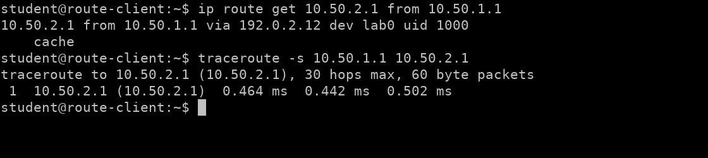
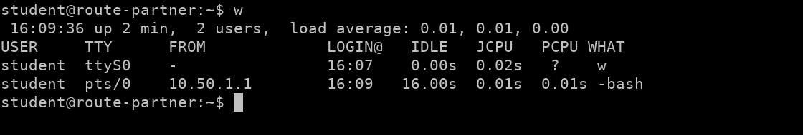

# Partnered routing

### **Task 1: Configuring VMware in Bridged Mode**

- Open VMware Workstation and select your Debian VM.
- Access the VM's settings and navigate to **Network Adapter**.
- Set the network mode to **Bridged** and ensure **Connect at power on** is checked.
- Start your VM and ensure it obtains an IP address from the school's DHCP pool.

### **Task 2: Setting Up the Tunnel Adapter**

- Open a terminal on your Debian VM.
- Refer to the provided spreadsheet to determine your assigned tunnel adapter address.
- Configure your tunnel adapter with the assigned address:
  ```bash
  sudo ip tuntap add mode tun tun0
  sudo ip addr add [Your Assigned Address] dev tun0
  sudo ip link set tun0 up
  ```

### **Task 3: Establishing Static Routes**

- Exchange IP addresses with your partner. These should be the addresses assigned by the school's DHCP server.
- Set up a static route to your partner's assigned network:
  **`sudo ip route add [Partner's Assigned Network] via [Partner's DHCP IP]`**

### **Submission Guidelines**

- Set your VM’s hostname to your first initial and last name followed by `-Debian` (for example, `dduck-Debian`).
- Use the assigned tunnel addresses for these two partnered tests. The DHCP addresses are next hops for the routes you added above.

## **Screenshot 2: Partner Tunnel Traceroute**

**Requirement:** Show the traceroute command and output. Use your assigned `tun0` address as the source and your partner’s assigned `tun0` address as the destination. The destination must appear in the result.

Use `man traceroute` to find the option that selects the source address before opening the worked example.

<details>
<summary>Worked example from two Debian VMs</summary>



The example uses `10.50.1.1` as the source and reaches `10.50.2.1`. Use the addresses from your assigned spreadsheet.

</details>

## **Screenshot 3: Partner SSH Source Address**

Connect to your partner’s assigned tunnel address. Replace the brackets and their contents with your values.

```text
ssh -b [Your Tunnel Adapter IP] [username]@[Partner's Tunnel Adapter IP]
```

The `-b` option sets your tunnel address as the source of the SSH connection. After signing in to your partner’s VM, run `w`.

**Requirement:** Show your partner’s prompt and the SSH session in the `w` output. The session’s `FROM` column must show your assigned tunnel address.



In the worked example, the remote SSH session is on `pts/0`. The `ttyS0` row is the partner’s local console session.

---
[Prev](03_routing.md) | [Home](README.md)
