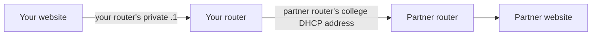

# Group Networking: Routers and Websites

Work in groups of three or four. Each person uses their own Debian VM on their own computer, with the adapter set to **Bridged**. Keep the college DHCP address. You will add a group address to the same adapter.

One person is the router. The other two or three run websites. Your group will connect to another group, then try a third.

## Your group network

Open the [network allocation spreadsheet](<./assets/Group Routing Network Allocation.xlsx>). Record your assigned group, real names, roles and the router's college DHCP address. Exchange these details with your partners.

| Role | Address for Group G | Group 1 example |
|---|---|---|
| Router | `10.77.G.1/24` | `10.77.1.1/24` |
| Website 1 | `10.77.G.11/24` | `10.77.1.11/24` |
| Website 2 | `10.77.G.12/24` | `10.77.1.12/24` |
| Website 3 (four-person group) | `10.77.G.13/24` | `10.77.1.13/24` |

Each group has a different `/24`. Although everyone shares the college switch, different IP networks still need routing. This gives you logical networks on the same physical network.



## Prepare each VM

Reboot to clear temporary addresses and routes from Lab 050. Find the bridged interface and its college DHCP address:

```bash
ip address
ip route
```

Use the interface name before the colon, such as `ens33`, in the commands below. Record the router's DHCP address in the spreadsheet.

Set a hostname using your first initial, last name and role. For example:

```bash
sudo hostnamectl set-hostname dduck-web1
sudo nano /etc/hosts
```

Update the existing `127.0.1.1` entry to match. Open a new terminal to see your hostname in the prompt.

## Save your group setup

You used forwarding and ICMP redirects in Lab 040. The script below sets those options and adds the addresses and routes for this exercise. Save it on **each VM**:

```bash
nano ~/restore-group-network.sh
```

Change these four variables for that VM:

- **`IF`:** your bridged interface.
- **`GROUP`:** your allocated group number, 1–10.
- **`HOST`:** `1` for the router; `11`, `12` or `13` for a website.
- **`ROLE`:** `router` or `web`.

```bash
#!/bin/sh
set -eu
IF=ens33
GROUP=1
HOST=11
ROLE=web

case "$GROUP" in 1|2|3|4|5|6|7|8|9|10) ;; *) echo "Group must be 1–10" >&2; exit 1 ;; esac
case "$ROLE:$HOST" in router:1|web:11|web:12|web:13) ;; *) echo "Use router:1 or web:11/12/13" >&2; exit 1 ;; esac

PRIVATE="10.77.$GROUP.$HOST"
GATEWAY="10.77.$GROUP.1"

# Add an additional address; preserve the college DHCP address and default route.
sudo ip address replace "$PRIVATE/24" dev "$IF"

# Same-interface forwarding can generate ICMP redirects. Ignore them so lab
# nodes keep using their group router instead of learning a shortcut.
{
    if [ "$ROLE" = router ]; then
        printf '%s\n' 'net.ipv4.ip_forward=1'
    fi
    printf '%s\n' 'net.ipv4.conf.all.accept_redirects=0'
    printf '%s\n' 'net.ipv4.conf.default.accept_redirects=0'
    printf 'net.ipv4.conf.%s.accept_redirects=0\n' "$IF"
    if [ "$ROLE" = router ]; then
        printf '%s\n' 'net.ipv4.conf.all.send_redirects=0'
        printf '%s\n' 'net.ipv4.conf.default.send_redirects=0'
        printf 'net.ipv4.conf.%s.send_redirects=0\n' "$IF"
    fi
} | sudo tee /etc/sysctl.d/90-group-routing-lab.conf >/dev/null
sudo sysctl -p /etc/sysctl.d/90-group-routing-lab.conf

if [ "$ROLE" = router ]; then
    # Keep unknown lab destinations out of the college default gateway.
    # More-specific connected/static/OSPF /24 routes still take precedence.
    sudo ip route replace unreachable 10.77.0.0/16
fi

if [ "$ROLE" = web ]; then
    sudo ip route replace 10.77.0.0/16 via "$GATEWAY" dev "$IF" src "$PRIVATE"
fi

ip address show dev "$IF"
ip route
```

### Script breakdown

- **`set -eu` and `case`:** stop on an error or invalid group/role combination.
- **`PRIVATE` and `GATEWAY`:** build this VM's address and its router address from your group number.
- **`ip address replace`:** add the private address beside DHCP. You can run it again without adding a duplicate.
- **`ip_forward=1`:** let the router forward packets, as you did in Lab 040.
- **Redirect settings:** keep website traffic using its group router instead of learning a shortcut across the shared switch.
- **`printf … | sudo tee`:** write those settings to `/etc/sysctl.d/90-group-routing-lab.conf`. `sysctl -p` applies the file.
- **Router's `unreachable` route:** catch unknown lab networks. A known `/24` route wins over this `/16`; otherwise the router rejects the packet.
- **Website's `via … src …` route:** send other groups' lab traffic through your own router, using your private address for replies.

Run it:

```bash
chmod +x ~/restore-group-network.sh
~/restore-group-network.sh
```

Check that the interface has **both** addresses and the college default route remains. On the router, forwarding should show `1`. Your website VM's route to other groups should use your private `.1` router. This is routing, without NAT.

**After a reboot:** run this script again and update the spreadsheet if DHCP changed. During static routing, re-add that router's partner routes. During OSPF, restart FRR after restoring the private address.

## Make your website

On each website VM:

```bash
sudo apt update
sudo apt install nginx curl
sudo systemctl start nginx
sudo nano /var/www/html/index.html
```

Use your own first name and group. Example:

```html
<!doctype html>
<html lang="en">
<head><title>Donald's website</title></head>
<body><h1>Donald's website</h1><p>Group 1 — Website 1</p></body>
</html>
```

Check it locally, then check the other websites in your group:

```bash
curl http://localhost/
curl http://10.77.1.11/
curl http://10.77.1.12/
```

Use your own group addresses. A four-person group also checks `.13`. Each response should show its owner's name. Keep the websites running for the next two parts.

---
[Home](README.md) | [Next](02_group-static-routing.md)
