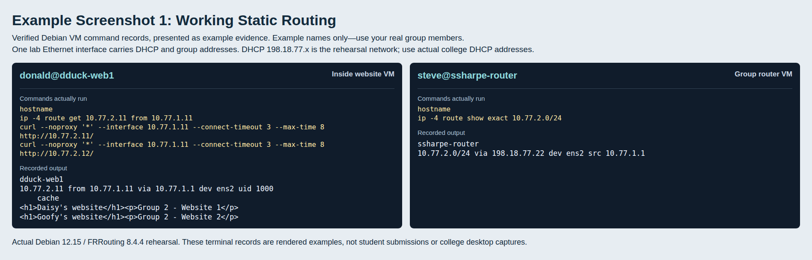
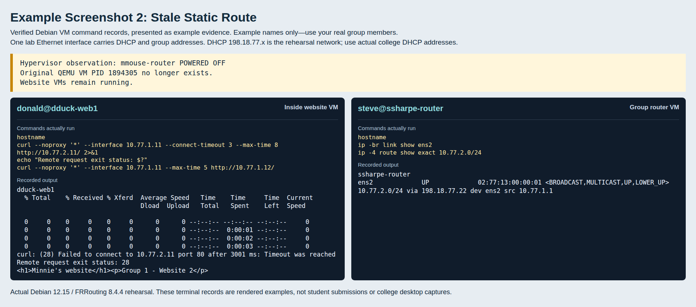

# Group Static Routing: Connect, Then Lose a Router

Keep your addressing and websites from [Group Networking](./01_group-networking.md). Exchange network and router DHCP addresses with a partner group.

## Add reciprocal routes

The next hop is the **partner router's college DHCP address**, not its private `.1`. Check it from your router:

```bash
ip route get PARTNER_ROUTER_DHCP_IP
ping PARTNER_ROUTER_DHCP_IP
```

Replace the placeholder with the actual address. It should be directly reachable on your bridged interface. Press `Ctrl+C` to stop ping.

Example: Group 1 connects to Group 2:

```bash
sudo ip route add 10.77.2.0/24 via PARTNER_ROUTER_DHCP_IP
ip route show 10.77.2.0/24
```

Replace `PARTNER_ROUTER_DHCP_IP` with the actual DHCP address. **`10.77.2.0/24`** is the destination network; **`via`** is the router that gets you there. Use your partner's network instead of Group 2 if yours differs.

The partner adds the route back to **your** network using your router's DHCP address. Requests and replies both need a route.

## Check the websites

From a website VM, use your own private address and your partner's website addresses:

```bash
hostname
ip route get 10.77.2.11
curl http://10.77.2.11/
curl http://10.77.2.12/
```

The route lookup should show your own router, such as `via 10.77.1.1`, and your private `src` address. Both named pages should appear. If the partner group has three websites, check `.13` too.

## **Screenshot 1: Working Static Routing**

**Requirement:** Show:

- **#1:** Your website VM's hostname and route lookup through your own router.
- **#2:** All partner websites returning their owners' names.
- **#3:** Your router's hostname and static `/24` route through the partner's DHCP address.

Use side-by-side terminals, or SSH to your router. Add the screenshot to matching screenshot slide.



## Challenge: a third group

Try connecting a third group. Each router needs a route to each other group's network, directly through that group's DHCP router address. Coordinate the return routes too.

Connecting A to B and B to C does not give A a route to C. Notice how much information you have to exchange and how easily a wrong address or missing return route breaks connectivity. No extra screenshot is required.

## Remove the partner router

Confirm the partner websites work. Power off **only the partner router**, leaving its websites and your router running:

```bash
sudo poweroff
```

On your router, check your own interface and the partner route:

```bash
hostname
ip link show dev ens33
ip route show 10.77.2.0/24
```

Use your actual interface and partner network. Your interface stays `UP`, and the static route stays there. It still points at the router that has gone away.

On your website VM:

```bash
hostname
curl --max-time 8 http://10.77.2.11/
echo "Remote exit status: $?"
curl http://10.77.1.12/
```

`--max-time 8` ends the failed request after eight seconds. The remote request should fail with a nonzero exit status; another website in your own group should still work.

## **Screenshot 2: Stale Static Route**

**Requirement:** On one slide, show:

- **#1:** The partner router VM powered off.
- **#2:** Your router's hostname, interface still `UP`, and partner `/24` route still present.
- **#3:** Your website VM's hostname, failed remote request with nonzero status, and working local website.

Your partner can supply the VMware power-state image; place it beside your terminal evidence on matching screenshot slide.



The route tells you what was configured, not whether the path still works. Someone must notice the failure and change the static route.

## Swap roles

Start the partner router and run its restore script. **Re-add its partner route:** rebooting removed it. Check both DHCP addresses and update the other router's route if its next hop changed. Confirm the websites work, then swap which group observes and which router powers off so both groups get Screenshot 2.

Bring both routers back before the OSPF section.

---
[Prev](01_group-networking.md) | [Home](README.md) | [Next](03_group-ospf.md)
