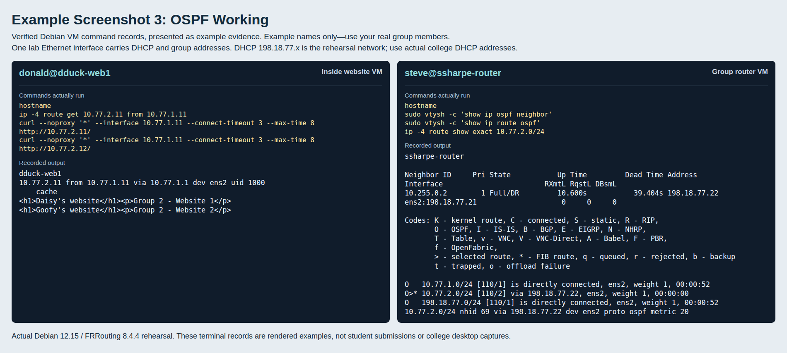
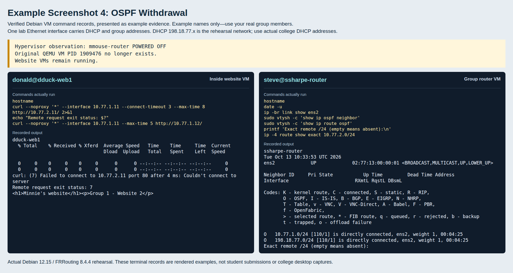
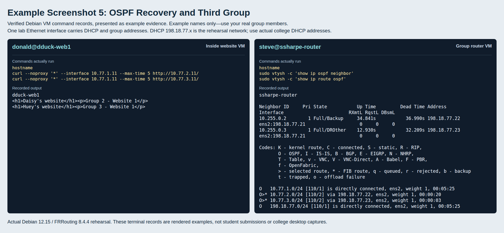

# Group OSPF: Learn Routes and Detect a Missing Router

You just entered every partner route by hand. Now use **OSPF** to let the routers exchange their networks. Keep the same websites, group addresses and bridged adapters.

## Remove the static partner routes

On each router, remove the remote `/24` routes you added. Example for a router that connected to Groups 2 and 3:

```bash
sudo ip route del 10.77.2.0/24
sudo ip route del 10.77.3.0/24
ip route
```

Use your actual partner networks. Only delete routes you added. Keep your local group network, college default route and unreachable lab `/16`. A leftover static route would hide OSPF's withdrawal.

## Install FRRouting

On **routers only**:

```bash
sudo apt update
sudo apt install frr
sudo nano /etc/frr/daemons
```

Change `ospfd=no` to **`ospfd=yes`**, then start the service:

```bash
sudo systemctl restart frr
sudo systemctl status frr
```

FRR provides the routing software; `ospfd` is its OSPF service. The website VMs keep using their own router.

## Find the college network

On your router:

```bash
ip route
```

Find the directly connected network whose `src` is your college DHCP address. For example, `192.0.2.0/24 dev ens33 ... src 192.0.2.21` means the college network is `192.0.2.0/24`. The other connected network, `10.77.G.0/24`, is your group network.

## Configure OSPF: this should look familiar

You already know Cisco IOS. FRR's **`vtysh`** uses a similar CLI, with a few syntax differences. Enter it from the Linux terminal:

```bash
sudo vtysh
```

Example for **Group 1**, interface **ens33** and college network **192.0.2.0/24**. Substitute your actual group, interface and college network:

```text
configure terminal
router ospf
 ospf router-id 10.255.0.1
 network 192.0.2.0/24 area 0.0.0.0
 network 10.77.1.0/24 area 0.0.0.0
exit
interface ens33
 ip ospf passive 10.77.1.1
 ip ospf hello-interval 10
 ip ospf dead-interval 40
exit
end
write memory
exit
```

### Cisco IOS → FRR

| FRR command | What you know from IOS / what it does |
|---|---|
| `configure terminal`, `exit`, `end` | Same configuration-mode navigation. |
| `router ospf` | Like IOS `router ospf 1`, but this lab's FRR instance has no process number in the command. |
| `ospf router-id 10.255.0.1` | IOS uses `router-id`. Use `10.255.0.G` as your group's unique OSPF identifier. |
| `network 192.0.2.0/24 area 0.0.0.0` | IOS uses a wildcard mask, such as `network 192.0.2.0 0.0.0.255 area 0`. FRR uses `/24`. Both select interface addresses where OSPF runs; dotted `0.0.0.0` means area 0. |
| `network 10.77.1.0/24 area 0.0.0.0` | Include your group network so other routers learn it. |
| `interface ens33` | Your Linux interface name replaces a Cisco name such as `GigabitEthernet0/0`. |
| `ip ospf passive 10.77.1.1` | Advertise your private network without sending hellos on that address. IOS commonly makes a whole LAN interface passive; here **both addresses share one interface**, so only the private address is passive. |
| `ip ospf hello-interval 10` / `ip ospf dead-interval 40` | The familiar hello/dead timers. Routers must agree. The dead timer is what you will observe when a partner disappears. |
| `write memory` | Save the FRR configuration, like saving the IOS running configuration. |

Keep the college address active for neighbor discovery. Making the **whole interface** passive would silence your neighbors too. This configuration uses `network` statements; no interface `ip ospf area` command is needed.

Your partner repeats the configuration with their own private network and unique router ID. Start with two groups. Other groups may appear as they enable OSPF on the shared college network.

## Check the routes and websites

On your router:

```bash
hostname
sudo vtysh -c 'show ip ospf neighbor'
sudo vtysh -c 'show ip route ospf'
ip route
```

The show commands will look familiar from IOS. FRR also installs learned routes into Linux's routing table, where they show **`proto ospf`**. Your partner's next hop should be their college DHCP address.

With two routers, wait for **Full**. With more routers, some neighbors may show **2-Way**; routers form Full adjacencies with the designated and backup designated routers.

On a website VM, check all partner websites using your actual addresses:

```bash
hostname
ip route get 10.77.2.11
curl http://10.77.2.11/
curl http://10.77.2.12/
```

The website still uses its own router and private source address. OSPF changes how **the routers** learn the remote path. Check `.13` too if the partner has a third website.

## **Screenshot 3: OSPF Working**

**Requirement:** Show:

- **#1:** Your router's hostname and OSPF neighbor, including the partner router ID.
- **#2:** The partner `/24` in FRR and Linux (`proto ospf`), through their DHCP address.
- **#3:** Your website VM's hostname and all partner websites returning their owners' names.

Use side-by-side terminals and add the screenshot to matching screenshot slide.



## Remove the partner router

Confirm the websites work, then power off the **partner router** again. Keep its website VMs and your own router running.

On your router, use your actual interface and partner network:

```bash
hostname
ip link show dev ens33
sudo vtysh -c 'show ip ospf neighbor'
sudo vtysh -c 'show ip route ospf'
ip route show 10.77.2.0/24
```

Repeat the last three commands after about a minute. The dead interval is 40 seconds since the last hello; an orderly shutdown can withdraw the route sooner. The partner neighbor and remote `/24` should disappear from FRR and Linux. Your own interface stays up.

On your website VM:

```bash
hostname
curl --max-time 8 http://10.77.2.11/
echo "Remote exit status: $?"
curl http://10.77.1.12/
```

The remote request fails, while your own group's website still works.

## **Screenshot 4: OSPF Withdrawal**

**Requirement:** On one slide, show:

- **#1:** The partner router VM powered off.
- **#2:** Your router's hostname and interface still `UP`, with the partner neighbor and `/24` gone from FRR and Linux.
- **#3:** Your website VM's hostname, failed remote request with nonzero status, and working local website.

Place your partner's VMware power-state image beside your terminal evidence on matching screenshot slide.



Compare this with Screenshot 2. **Static routing kept the configured route. OSPF detected the missing neighbor and withdrew the path.** Neither can reach the stopped network without another working path.

Restore the router and swap observer roles so both groups collect this evidence. Run its restore script, check DHCP, then `sudo systemctl restart frr`.

## Recovery and a third group

Bring both routers back with their restore scripts and restart FRR. Watch the neighbors and routes return, then check the websites.

Invite a third group to enable OSPF using **its own** network and router ID. You do not enter static routes for that group: it advertises its network, and yours learns it.

On your router:

```bash
hostname
sudo vtysh -c 'show ip ospf neighbor'
sudo vtysh -c 'show ip route ospf'
```

On your website VM, use your actual partner and third-group addresses:

```bash
hostname
curl http://10.77.2.11/
curl http://10.77.3.11/
```

Have the third group check your websites too.

## **Screenshot 5: OSPF Recovery and Third Group**

**Requirement:** Show:

- **#1:** Your router's hostname, with the recovered partner and third group's neighbors and learned `/24` routes.
- **#2:** Your website VM's hostname and successful requests to a website in each of those groups, showing both owners' names.

Add the screenshot to matching screenshot slide.



## Classroom challenge

Try connecting with the remaining groups. Compare your learned networks with the spreadsheet and visit their websites. Think about how many static routes you would have needed instead. No extra screenshot is required.

## Finish

On all VMs, remove the settings file:

```bash
sudo rm /etc/sysctl.d/90-group-routing-lab.conf
```

On routers, edit `/etc/frr/daemons` back to `ospfd=no` and restart FRR. Reboot all VMs to clear the temporary lab addresses and routes. Leave the restore script unused afterward.

### If a website does not respond

Check its address and Nginx first, then forwarding and the route in **both directions**. For OSPF, check matching area and timers and that the college address is active. A leftover static route can also hide the withdrawal test.

### References

- [FRRouting OSPF](https://docs.frrouting.org/en/latest/ospfd.html)
- [Linux forwarding and redirects](https://www.kernel.org/doc/html/latest/networking/ip-sysctl.html)

---
[Prev](02_group-static-routing.md) | [Home](README.md)
