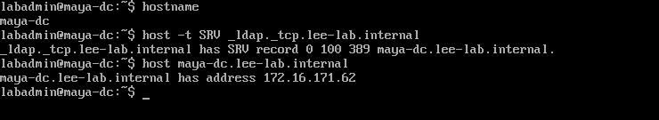

# Create the domain

[← Before you start](./01-before-you-start.md) · [Lab overview](./README.md) · [Join Windows →](./03-join-windows.md)

On Debian, open `/etc/hosts` with `sudo nano /etc/hosts`. Add a line with your Debian VM’s IPv4 address, full name, and short name. Remove any `127.0.1.1` mapping for this VM’s old or new hostname. Keep `127.0.0.1 localhost`. Use your own IP address, first name, and last-name domain in place of the example below.

```text
192.168.50.10 maya-dc.lee-lab.internal maya-dc
```

Prepare Samba and run the interactive setup:

```bash
sudo systemctl disable --now smbd nmbd winbind
sudo systemctl mask smbd nmbd winbind
sudo mv /etc/samba/smb.conf /etc/samba/smb.conf.orig
sudo samba-tool domain provision --interactive
```

`disable --now` stops the standalone services and keeps them from starting at boot. `mask` prevents them from starting while the domain controller owns their duties. Moving the original configuration gives Samba a free filename for its new configuration.

| Prompt                 | Enter                                                                   |
|------------------------|-------------------------------------------------------------------------|
| Realm                  | Your last-name domain in uppercase, such as `LEE-LAB.INTERNAL`          |
| Domain (NetBIOS)       | `LAB`. Enter this explicitly to keep account names such as `LAB\alice`. |
| Server role            | `dc`                                                                    |
| DNS backend            | `SAMBA_INTERNAL`                                                        |
| DNS forwarder          | Your upstream DNS server's IP. Enter `none` if you only need lab names. |
| Administrator password | Choose and record a strong lab password. Use it only for this lab.      |

Install the Kerberos configuration that Samba generated.

```bash
sudo cp /var/lib/samba/private/krb5.conf /etc/krb5.conf
```

Point this dedicated lab VM at its own Samba DNS. First, check which resolver Debian is using.

```bash
ls -l /etc/resolv.conf
systemctl is-active systemd-resolved
```

On a typical Debian install, `/etc/resolv.conf` is a regular file and the service reports `inactive`. If the service reports `active`, run `sudo systemctl disable --now systemd-resolved` before continuing. Samba will provide DNS for this VM.

Back up the resolver file and open a new one:

```bash
sudo mv /etc/resolv.conf /etc/resolv.conf.orig
sudo nano /etc/resolv.conf
```

Enter the following two lines. In Nano, save with **Ctrl+O**, **Enter**, then exit with **Ctrl+X**.

```text
nameserver 127.0.0.1
search lee-lab.internal
```

```bash
sudo systemctl unmask samba-ad-dc
sudo systemctl enable --now samba-ad-dc
hostname
host -t SRV _ldap._tcp.lee-lab.internal
host maya-dc.lee-lab.internal
```

Windows uses the SRV record to find `maya-dc.lee-lab.internal` on port 389 and the A record to find its IPv4 address. Compare both lookups with the example below. Your address should match your Debian VM. If either lookup fails, check `systemctl status samba-ad-dc` and the address in `/etc/hosts` before joining Windows.

## **Screenshot 1: Domain Controller DNS**

**Requirement:** Show `hostname` and the LDAP SRV lookup in the same Debian terminal. Your `-DC` name must be visible, and the SRV result must point to that host in your last-name domain on port 389.



The Debian hostname and SRV record show the first and last names used in the lab. The A record shows the example VM’s IPv4 address.

Create two domain users and two groups. Enter a separate lab password at each user prompt. `addmembers` takes the group name first and the username second.

```bash
sudo samba-tool user create alice
sudo samba-tool user create bob
sudo samba-tool group add Editors
sudo samba-tool group add Reviewers
sudo samba-tool group addmembers Editors alice
sudo samba-tool group addmembers Reviewers bob
```

[← Before you start](./01-before-you-start.md) · [Lab overview](./README.md) · [Join Windows →](./03-join-windows.md)
