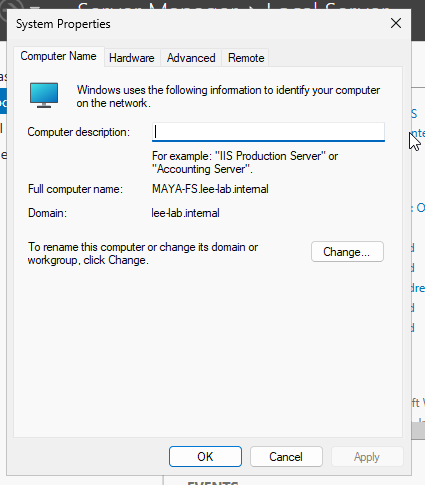
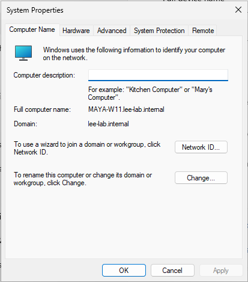

# Join Windows

[← Create the domain](./02-create-the-domain.md) · [Lab overview](./README.md) · [Publish Samba shares →](./04-publish-samba-shares.md)

The [interactive HTML lab](./index.html) includes a short DNS discovery activity after you set Preferred DNS.

Do this on **Windows Server and Windows 11**. Start the second VM's join while the first restarts.

1.  Open **Control Panel → Network and Internet → Network and Sharing Center → Change adapter settings**. Right-click the active adapter and select **Properties**.
2.  Open **Internet Protocol Version 4 (TCP/IPv4)**. Keep the existing IP settings. Select **Use the following DNS server addresses**. Enter the Debian VM's IPv4 address as the preferred DNS server and leave Alternate blank. Click **OK** in both properties windows.
3.  Open the **Computer Name** tab in **System Properties** using the path for your VM.
    - On **Windows Server**, open **Server Manager → Local Server** and click the **Workgroup** link.
    - On **Windows 11**, search Start for **About your PC**. Under **Related links**, click **Domain or workgroup**.
4.  Select **Change → Domain**, enter your last-name domain, such as `lee-lab.internal`, and click **OK**. When prompted, sign in with `LAB\Administrator` and the password created on Debian.
5.  When Windows welcomes you to your domain, restart. Open **System Properties → Computer Name** again on each VM. Verify each computer name and your last-name domain.

If the join cannot find the domain, follow the [domain DNS checks](./07-troubleshooting.md#domain-dns-checks).

## **Screenshot 2: Both Windows Domain Members**

**Requirement:** Show both System Properties → Computer Name tabs with your `-FS` and `-W11` names and your last-name domain. Put both captures on the same slide.



Windows Server member with its first-name computer name and last-name domain.



Windows 11 member with its first-name computer name and last-name domain.

### Optional CLI (untested)

The GUI steps above are the main path. After setting adapter DNS, these PowerShell checks resolve the domain controller and display the computer's join status.

```powershell
Resolve-DnsName maya-dc.lee-lab.internal
Get-CimInstance Win32_ComputerSystem | Select-Object Name, Domain, PartOfDomain
```

[← Create the domain](./02-create-the-domain.md) · [Lab overview](./README.md) · [Publish Samba shares →](./04-publish-samba-shares.md)
