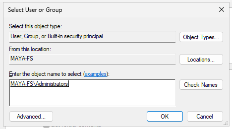
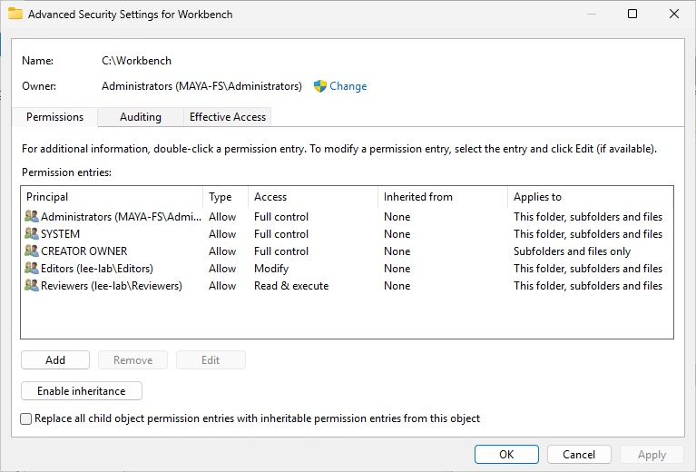
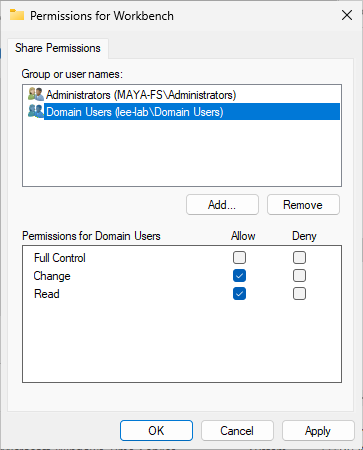

# Set Windows permissions

[← Publish Samba shares](./04-publish-samba-shares.md) · [Lab overview](./README.md) · [Test as Alice and Bob →](./06-test-as-alice-and-bob.md)

Curious why ADUC shows Administrators but the folder picker can miss it? [See what the picker is searching](./07-troubleshooting.md#administrators-lookup). The interactive HTML also has **Local vs. domain group lookup** in Troubleshooting.

On **Windows Server**, sign in as `LAB\Administrator`.

1.  In File Explorer, create **C:\Workbench**. Right-click the folder and open **Properties → Security → Advanced**.

2.  Select **Disable inheritance → Convert inherited permissions into explicit permissions**. Keep **SYSTEM** and the server’s local **Administrators** entry. If the entry is missing, see [how to look up the local group](./07-troubleshooting.md#administrators-lookup). Remove every **Users** or **Authenticated Users** entry you see. There can be two **MAYA-FS\Users** entries. Do this only on the new Workbench folder.

    

    In **Locations**, choose your own `-FS` computer.

3.  Select **Add → Select a principal** and enter `LAB\Editors`. Select **Check Names**, then **OK**. Set **Type** to **Allow**, **Applies to** to **This folder, subfolders and files**, and tick **Modify**. Select **OK**.

4.  Add `LAB\Reviewers` the same way. Select **Read & execute**. Windows also selects **List folder contents** and **Read**. Leave **Write** and **Modify** clear. Apply the changes.

    

    The Editors and Reviewers entries have the expected NTFS access. The pilot dialog displays the group names with `lee-lab`.

5.  Inside **Workbench**, create `event.txt` with the line **Update the event plan here.** Creating it now lets the file inherit the folder permissions.

6.  Open **Workbench → Properties → Sharing → Advanced Sharing**. Tick **Share this folder**, leave the name **Workbench**, and open **Permissions**. Add `LAB\Domain Users` and allow **Change** and **Read**. Select **Add → Locations → MAYA-FS → OK**. Enter `Administrators`, choose **Check Names**, and confirm it resolves to `MAYA-FS\Administrators`. Allow **Full Control** for that group. Remove **Everyone**, then apply.

    

    Workbench share permissions on MAYA-FS. Domain Users has Change and Read.

In **Windows Defender Firewall with Advanced Security → Inbound Rules**, check for an enabled **File and Printer Sharing (SMB-In)** rule for the **Domain** profile. On the Server 2025 lab VM, **File and Printer Sharing (Restrictive) (SMB-In)** was already enabled for Domain. If the Domain rule is disabled, enable it. Keep the firewall enabled.

The share allows domain users to request changes. The NTFS access control list (ACL) in the **Security** tab controls who can change files. Both the share permissions and the NTFS ACL must allow an action for it to succeed over SMB.

### Optional CLI (untested)

Use this as an alternative to the folder and share steps above on a fresh VM. Open PowerShell as administrator. Set the Domain firewall rule with the GUI.

```powershell
New-Item -ItemType Directory -Path C:\Workbench
icacls C:\Workbench /grant:r "SYSTEM:(OI)(CI)F" "BUILTIN\Administrators:(OI)(CI)F" "LAB\Editors:(OI)(CI)M" "LAB\Reviewers:(OI)(CI)RX"
icacls C:\Workbench /inheritance:r
Set-Content -Path C:\Workbench\event.txt -Value 'Update the event plan here.'
New-SmbShare -Name Workbench -Path C:\Workbench -ChangeAccess 'LAB\Domain Users' -FullAccess 'BUILTIN\Administrators'
```

[← Publish Samba shares](./04-publish-samba-shares.md) · [Lab overview](./README.md) · [Test as Alice and Bob →](./06-test-as-alice-and-bob.md)
