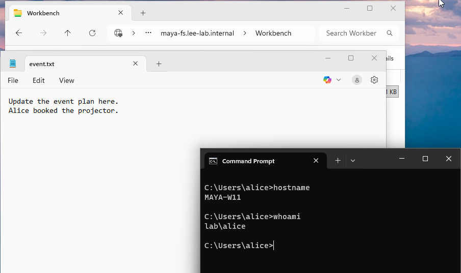
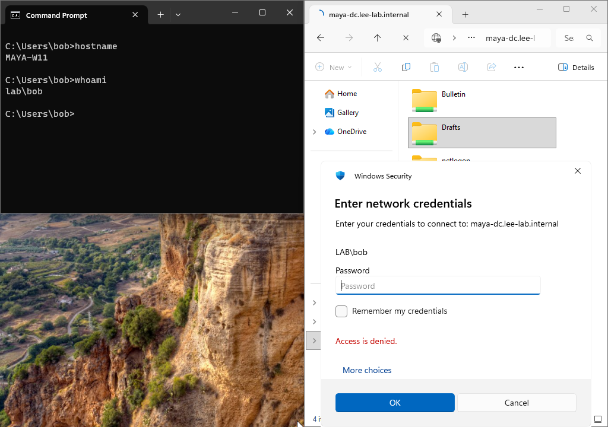

# Test as Alice and Bob

[← Set Windows permissions](./05-set-windows-permissions.md) · [Lab overview](./README.md) · [Troubleshooting →](./07-troubleshooting.md)

For help refreshing a user’s group membership, see [Domain sign-in](./07-troubleshooting.md#domain-sign-in). The interactive HTML has **When does Windows see a group change?** in Troubleshooting.

On **Windows 11**, choose **Other user** and sign in as `LAB\alice`. Paste each path below into File Explorer's address bar. Then **sign out** and repeat as `LAB\bob`. The first sign-in for each user can take a minute while Windows creates their profile. Signing out closes the previous user’s SMB sessions. The next sign-in also loads that user’s current group membership. File Explorer may show `event` or `draft` without the `.txt` extension.

### Show which VM and user ran the test

While signed in as Alice or Bob, open **Command Prompt** from Start and run:

```bat
hostname
whoami
```

Keep Command Prompt visible for each capture. The two commands show your `-W11` name and `lab\alice` or `lab\bob`. Arrange it with File Explorer and the test result so all are readable in a single capture. Open Command Prompt before the Drafts test so the denial dialog can stay open.

| Path                                   | Alice, an Editor                     | Bob, a Reviewer                                                                                                |
|----------------------------------------|--------------------------------------|----------------------------------------------------------------------------------------------------------------|
| `\\maya-dc.lee-lab.internal\Bulletin`  | Open `event.txt`                     | Open `event.txt`                                                                                               |
| `\\maya-dc.lee-lab.internal\Drafts`    | Open `draft.txt`                     | Access denied                                                                                                  |
| `\\maya-fs.lee-lab.internal\Workbench` | Open and edit `event.txt`, then save | Open `event.txt`, make a test edit, and try to save it to the same file in Notepad. Expect a permission error. |

If Notepad opens **Save As** for Bob, keep the Workbench folder and `event.txt` filename. Choose **Save**, then choose **Yes** if asked to replace the file. Windows 11 can say **You do not have permission to open this file** during the save attempt. Dismiss the dialog and discard the unsaved edit.

### Optional CLI (untested)

While signed in as Bob, run the following in PowerShell. It attempts to append one line. Expect an access-denied error.

    Add-Content '\\maya-fs.lee-lab.internal\Workbench\event.txt' 'Reviewer edit test'

After Alice saves, close the `event.txt` tab in Notepad and reopen the file from the Workbench share. Arrange the windows so Notepad shows the saved text and File Explorer’s address bar shows both the server and share for Screenshot 3. For Screenshot 4, open `\\maya-dc.lee-lab.internal` as Bob, then open **Drafts**. If Windows asks for network credentials, enter `LAB\bob` and Bob’s password once. Leave the **Access is denied** message and the server and selected share visible. Keep the password field empty in the capture, then select **Cancel**. If Windows reports a missing network path, check DNS and the share path.

## **Screenshot 3: Alice Saves to Workbench**

**Requirement:** Show Alice’s saved edit reopened from Workbench and the share path with your `-FS` hostname. Keep Command Prompt visible with your `-W11` name and `lab\alice`.



The reopened file, Workbench path, and Alice’s Command Prompt output are visible in one capture.

## **Screenshot 4: Bob Denied Access to Drafts**

**Requirement:** Show the Drafts denial, server, and selected share. Keep Command Prompt visible with your `-W11` name and `lab\bob`. Keep any password field empty.



Bob’s computer name and account, the selected Drafts share, and the access denial are visible in one capture.

If your results differ from the table, check [Workbench write permissions](./07-troubleshooting.md#workbench-save-checks) or [Workbench connectivity](./07-troubleshooting.md#workbench-connection-checks).

Add your four screenshots to the submission template. Use the results table to check your work. Explain why Bob can read Workbench but cannot save even though `Domain Users` has Change permission on the share. Then explain how Samba’s `valid users` setting affects Bob’s access to Drafts.

[← Set Windows permissions](./05-set-windows-permissions.md) · [Lab overview](./README.md) · [Troubleshooting →](./07-troubleshooting.md)
