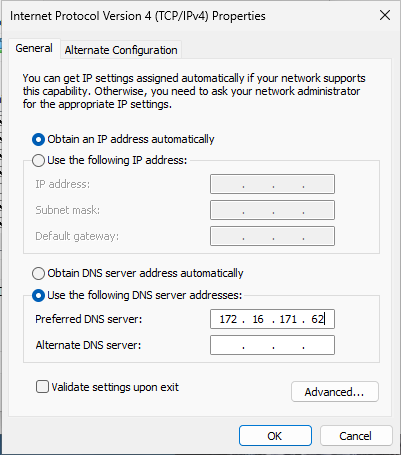
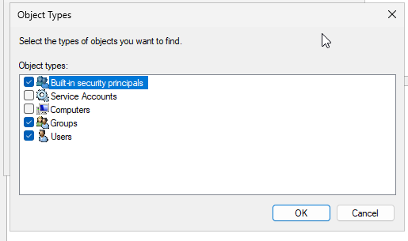
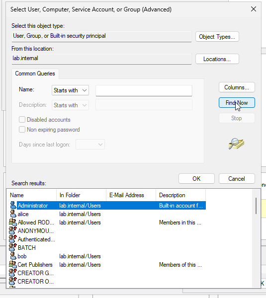
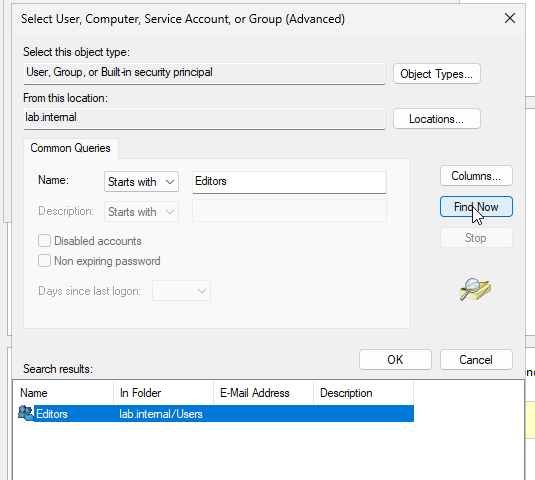
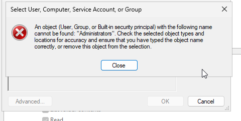
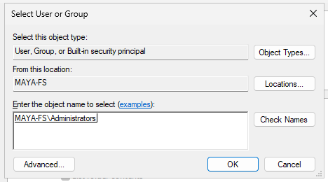
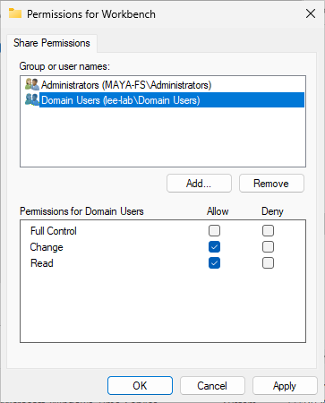
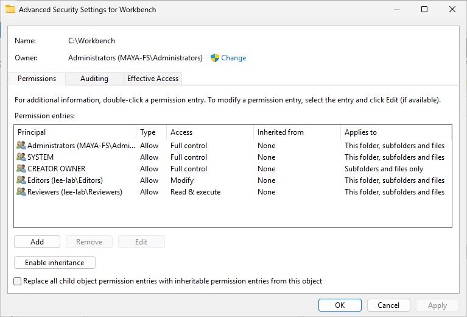

# Troubleshooting

[← Test as Alice and Bob](./06-test-as-alice-and-bob.md) · [Lab overview](./README.md)

### Domain DNS checks

1.  Check that the VMs are connected to the same private NAT network and have IPv4 addresses on that network. Keep automatic IP addressing on Windows if your lab uses DHCP.
2.  Check the Windows adapter’s IPv4 properties. Set **Preferred DNS server** to your Debian VM’s IPv4 address and leave **Alternate DNS server** blank.
3.  Repeat the [LDAP SRV and host A lookups](./02-create-the-domain.md#screenshot-1-domain-controller-dns) on Debian. The SRV record should point to `maya-dc.lee-lab.internal` on port 389. The A record should show your Debian address.

Windows 11 uses the Debian VM’s address for Preferred DNS. Enter your own Debian VM’s address.

### Domain sign-in

At the Windows 11 sign-in screen, choose **Other user** and enter `LAB\alice` or `LAB\bob`. Check the lab password and make sure the Windows and Debian clocks agree. If either user’s group membership changed, sign out and sign back in.

### Administrators lookup

**Why the search list can be confusing.** **Advanced → Find Now** can show well-known identities alongside domain groups. Look at **From this location** and the **In Folder** column to see where an entry comes from. In the pilot, Authenticated Users had a blank In Folder value, while Editors appeared under the domain’s Users container. Administrators, Users, Guests, and the other Builtin groups we sampled were all present in Samba AD, but the picker could not resolve them from that location.

Active Directory Users and Computers shows the domain’s **Administrators** group in its **Builtin** container. Workbench uses the **MAYA-FS** member server’s local **Administrators** group. [Microsoft’s Administrators group reference](https://learn.microsoft.com/en-us/windows-server/identity/ad-ds/plan/security-best-practices/appendix-b--privileged-accounts-and-groups-in-active-directory#administrators)

Typing `BUILTIN\Administrators` while searching **lee-lab.internal** can trigger a location error. Keep the existing local Administrators entry in Workbench’s **Security** permissions. If it is missing, open **Add → Select a principal → Locations**, choose **MAYA-FS**, enter `Administrators`, and select **Check Names**. It should resolve to `MAYA-FS\Administrators`. Allow **Full control** on this folder, subfolders, and files. Use the same location when adding Administrators in the share permissions. Use your last-name domain, such as **lee-lab.internal**, as the search location for **Editors** and **Reviewers**.

**Try a quick comparison.** In **Select User or Group**, search your lab domain for `Editors`. Then change **Locations** to your `-FS` server and check `Administrators`. The domain owns the first group, and the file server manages local Administrators. Select **Cancel** when you finish the comparison.

> “When the user selects a scope from the list, the dialog box applies the filters for that scope type”

[Microsoft Learn · Directory Object Picker](https://learn.microsoft.com/en-us/windows/win32/ad/directory-object-picker)

> “Membership in domain-joined computers' local Administrators group is where local privilege is granted”

[Microsoft Learn · Administrators groups](https://learn.microsoft.com/en-us/windows-server/identity/ad-ds/plan/security-best-practices/appendix-b--privileged-accounts-and-groups-in-active-directory#administrators)

#### What the picker showed in the pilot

These screens use FILESERVER and lab.internal. Substitute your own server name and domain.

Object Types controls what the picker searches. Both Groups and Built-in security principals were already selected in the pilot.

The domain search mixes directory entries and well-known identities. Look at In Folder before assuming an entry is in ADUC.

Editors resolves from the domain. In Folder shows lab.internal/Users in this pilot.

The same domain search could not resolve Administrators. The local lookup on the file server succeeds, as shown below.

In **Locations**, choose your own `-FS` computer.

### Workbench save checks

Check that you signed in as `LAB\alice`. On Windows Server, confirm that **Domain Users** has **Change** and **Read** in **Sharing → Advanced Sharing → Permissions**. Then open **Security → Advanced** and confirm that **Editors** has **Modify** on the folder, subfolders, and files.

#### Workbench share permissions

Workbench share permissions on MAYA-FS. Domain Users has Change and Read.

#### Workbench NTFS permissions

The Editors and Reviewers entries have the expected NTFS access. The pilot dialog displays the group names with `lee-lab`.

### Workbench connection checks

Check the share path `\\maya-fs.lee-lab.internal\Workbench` and the [Windows Server computer name and domain](./03-join-windows.md#screenshot-2-both-windows-domain-members). Confirm that the client and server use Debian for DNS. If the server name resolves, check the [Domain-profile SMB-In rule](./05-set-windows-permissions.md#set-windows-permissions) and confirm that **Workbench** is shared.

### Drafts access checks

This is the expected result. The Drafts share’s `valid users` permits **Editors**, and Bob belongs to **Reviewers**. Windows 11 can show **Enter network credentials** with **Access is denied** after Bob enters his credentials. Use the [Screenshot 4 example](./06-test-as-alice-and-bob.md#screenshot-4-bob-denied-access-to-drafts) to check what your dialog should show.

## References

- [Debian 13 Samba AD package](https://packages.debian.org/trixie/samba-ad-dc)
- [Debian DNS resolver](https://wiki.debian.org/resolv.conf)
- [Ubuntu Server: Provisioning a Samba AD domain controller](https://ubuntu.com/server/docs/how-to/samba/provision-samba-ad-controller/)
- [Samba share settings](https://www.samba.org/samba/docs/current/man-html/smb.conf.5.html)
- [Microsoft: Join a computer to a domain](https://learn.microsoft.com/windows-server/identity/ad-ds/manage/join-computer-to-domain)
- [Microsoft: Share and NTFS permissions](https://learn.microsoft.com/en-us/iis/web-hosting/configuring-servers-in-the-windows-web-platform/configuring-share-and-ntfs-permissions)

[← Test as Alice and Bob](./06-test-as-alice-and-bob.md) · [Lab overview](./README.md)
