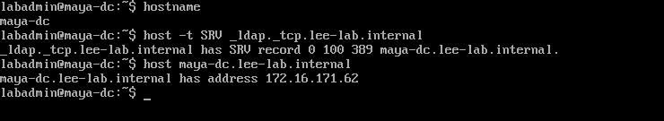
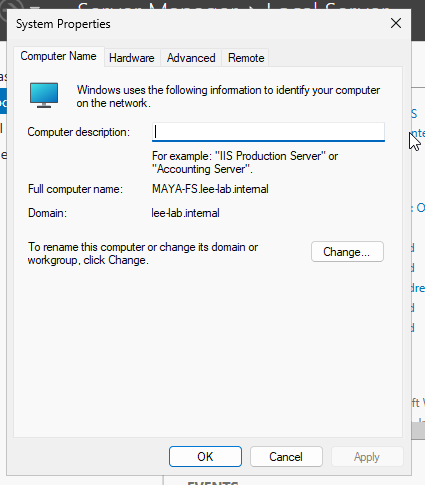
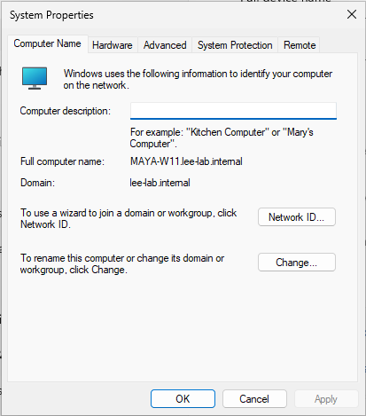
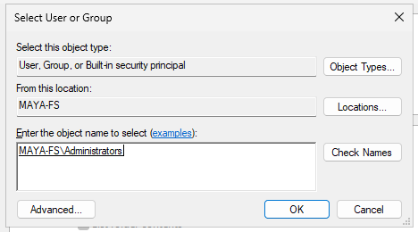
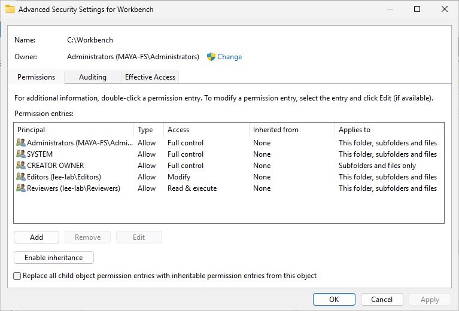
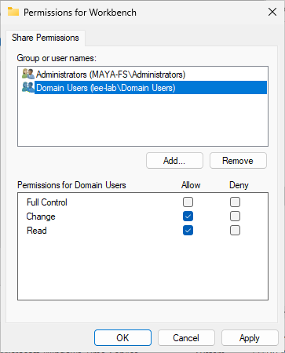
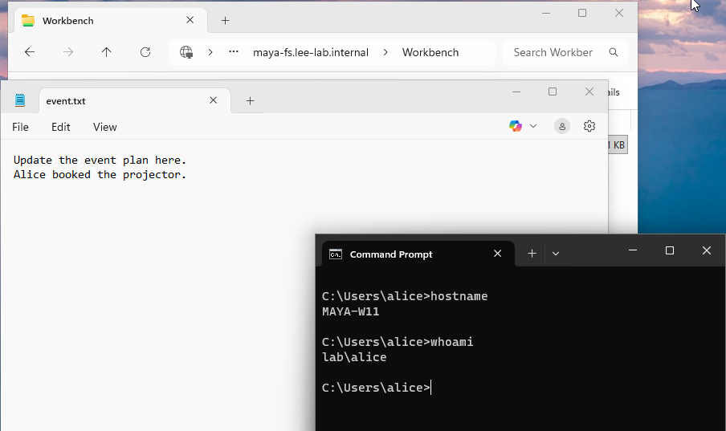
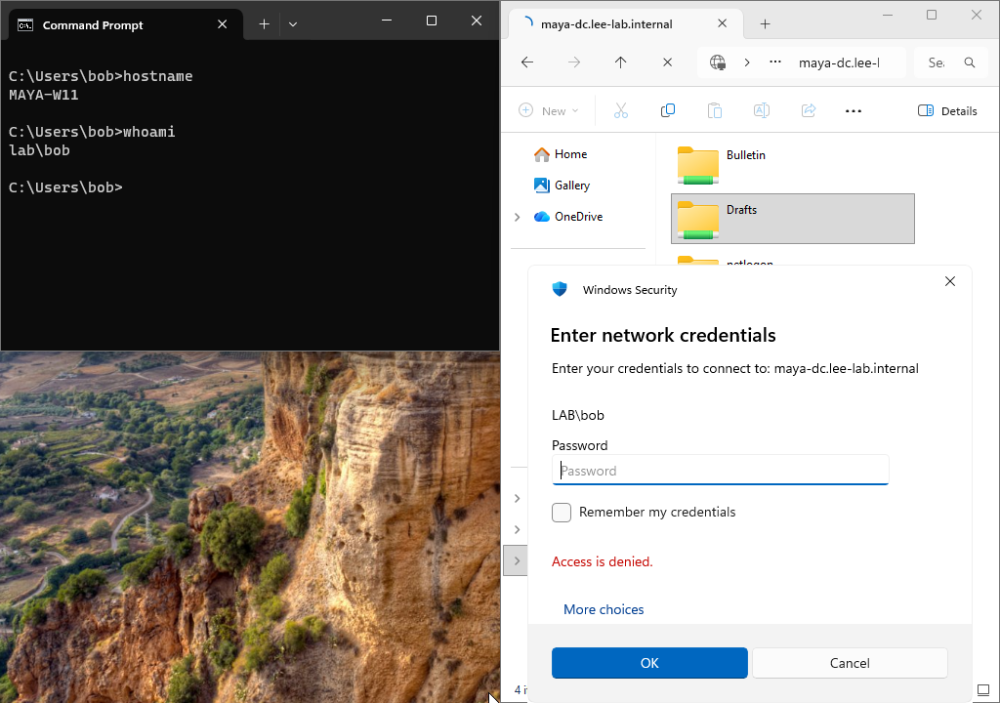
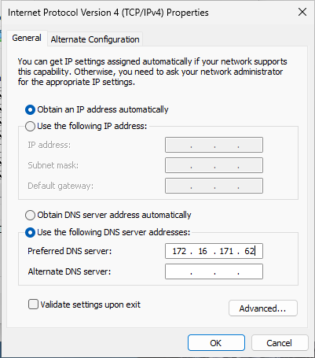

# Samba Active Directory and File Shares

> **Before you start:** Download the [Samba AD Lab Submission Template](https://github.com/WikiSteve/networking-labs/releases/download/samba-ad-lab-html/Samba-AD-Lab-Submission-Template.pptx). Add each required screenshot as you complete the lab, then submit the completed template for grading.

[Download the interactive HTML lab](https://github.com/WikiSteve/networking-labs/releases/download/samba-ad-lab-html/index.html?rev=2) · Open the downloaded `index.html` in your browser. The screenshots load from GitHub.

## Before you start

Your team is preparing an event. Everyone needs the bulletin. Only the editors should see the draft on Samba. On Windows Server, reviewers should be able to read the workbench without changing it. Use the same domain accounts on both servers.

### Name your VMs before configuration

Use your first name on all three VMs and your last name in the AD domain. Use letters A–Z and omit spaces and punctuation. If needed, shorten the first name to 11 letters so `-W11` fits the Windows computer name limit. This guide uses Maya Lee as its example. The computers are `maya-dc`, `MAYA-FS`, and `MAYA-W11`, and the domain is `lee-lab.internal`. Substitute your own names in the setup, DNS lookups, and share paths.

On Debian, set the hostname before provisioning Samba. Replace `maya` with your first name.

```bash
sudo hostnamectl set-hostname maya-dc
```

On Windows 11, use **Settings → System → About → Rename this PC** and set the `-W11` name. On Windows Server, use **Server Manager → Local Server**, click the current computer name, then choose **Computer Name → Change** and set the `-FS` name. Restart both before joining the domain.

| VM                                                  | Name       | Role                                                        |
|-----------------------------------------------------|------------|-------------------------------------------------------------|
| Fresh Debian 13 (Trixie)                            | `maya-dc`  | Samba domain controller, DNS, and two small practice shares |
| Windows Server 2022 or 2025 with Desktop Experience | `MAYA-FS`  | Domain member and Windows file server                       |
| Windows 11 Education                                | `MAYA-W11` | Domain member and test client                               |

Use your own VMs on one shared private NAT network. In VirtualBox, choose NAT Network for all three VMs and select the same network. Check that the VM clocks agree before joining. Avoid bridging the lab to the campus network. The 40-minute target starts after VM and package preparation. Check that the three VMs can reach each other and give Debian a stable IPv4 address. Write down the Debian address and the current DNS server for Internet lookups. Use local administrator accounts on Windows for setup. The Windows Server VM starts as a standalone server.

On Debian, install these packages before timing the lab:

```bash
sudo apt update
sudo apt install samba-ad-dc krb5-user bind9-dnsutils
```

Press Enter to accept the defaults if Kerberos setup asks for a realm or servers. You will replace its configuration during the lab.

### Four screenshots to submit

1. [Domain controller DNS with your hostname](#screenshot-1-domain-controller-dns)
2. [Both Windows domain members](#screenshot-2-both-windows-domain-members)
3. [Alice saves to Workbench](#screenshot-3-alice-saves-to-workbench)
4. [Bob is denied access to Drafts](#screenshot-4-bob-denied-access-to-drafts)

## 1. Create the domain

On Debian, open `/etc/hosts` with `sudo nano /etc/hosts`. Add a line with your Debian VM’s IPv4 address, full name, and short name. Remove any `127.0.1.1` mapping for this VM’s old or new hostname. Keep `127.0.0.1 localhost`. Use your own IP address, first name, and last-name domain in place of the example below.

```text
192.168.50.10 maya-dc.lee-lab.internal maya-dc
```

Prepare Samba and run the interactive setup:

```bash
sudo systemctl disable --now smbd nmbd winbind
sudo systemctl mask smbd nmbd winbind
sudo mv /etc/samba/smb.conf /etc/samba/smb.conf.orig
sudo samba-tool domain provision --interactive
```

`disable --now` stops the standalone services and keeps them from starting at boot. `mask` prevents them from starting while the domain controller owns their duties. Moving the original configuration gives Samba a free filename for its new configuration.

| Prompt                 | Enter                                                                   |
|------------------------|-------------------------------------------------------------------------|
| Realm                  | Your last-name domain in uppercase, such as `LEE-LAB.INTERNAL`          |
| Domain (NetBIOS)       | `LAB`. Enter this explicitly to keep account names such as `LAB\alice`. |
| Server role            | `dc`                                                                    |
| DNS backend            | `SAMBA_INTERNAL`                                                        |
| DNS forwarder          | Your upstream DNS server's IP. Enter `none` if you only need lab names. |
| Administrator password | Choose and record a strong lab password. Use it only for this lab.      |

Install the Kerberos configuration that Samba generated.

```bash
sudo cp /var/lib/samba/private/krb5.conf /etc/krb5.conf
```

Point this dedicated lab VM at its own Samba DNS. First, check which resolver Debian is using.

```bash
ls -l /etc/resolv.conf
systemctl is-active systemd-resolved
```

On a typical Debian install, `/etc/resolv.conf` is a regular file and the service reports `inactive`. If the service reports `active`, run `sudo systemctl disable --now systemd-resolved` before continuing. Samba will provide DNS for this VM.

Back up the resolver file and open a new one:

```bash
sudo mv /etc/resolv.conf /etc/resolv.conf.orig
sudo nano /etc/resolv.conf
```

Enter the following two lines. In Nano, save with **Ctrl+O**, **Enter**, then exit with **Ctrl+X**.

```text
nameserver 127.0.0.1
search lee-lab.internal
```

```bash
sudo systemctl unmask samba-ad-dc
sudo systemctl enable --now samba-ad-dc
hostname
host -t SRV _ldap._tcp.lee-lab.internal
host maya-dc.lee-lab.internal
```

Windows uses the SRV record to find `maya-dc.lee-lab.internal` on port 389 and the A record to find its IPv4 address. Compare both lookups with the example below. Your address should match your Debian VM. If either lookup fails, check `systemctl status samba-ad-dc` and the address in `/etc/hosts` before joining Windows.

## **Screenshot 1: Domain Controller DNS**

**Requirement:** Show `hostname` and the LDAP SRV lookup in the same Debian terminal. Your `-DC` name must be visible, and the SRV result must point to that host in your last-name domain on port 389.



The Debian hostname and SRV record show the first and last names used in the lab. The A record shows the example VM’s IPv4 address.

Create two domain users and two groups. Enter a separate lab password at each user prompt. `addmembers` takes the group name first and the username second.

```bash
sudo samba-tool user create alice
sudo samba-tool user create bob
sudo samba-tool group add Editors
sudo samba-tool group add Reviewers
sudo samba-tool group addmembers Editors alice
sudo samba-tool group addmembers Reviewers bob
```

## 2. Join Windows

The [interactive HTML lab](./index.html) includes a short DNS discovery activity after you set Preferred DNS.

Do this on **Windows Server and Windows 11**. Start the second VM's join while the first restarts.

1.  Open **Control Panel → Network and Internet → Network and Sharing Center → Change adapter settings**. Right-click the active adapter and select **Properties**.
2.  Open **Internet Protocol Version 4 (TCP/IPv4)**. Keep the existing IP settings. Select **Use the following DNS server addresses**. Enter the Debian VM's IPv4 address as the preferred DNS server and leave Alternate blank. Click **OK** in both properties windows.
3.  Open the **Computer Name** tab in **System Properties** using the path for your VM.
    - On **Windows Server**, open **Server Manager → Local Server** and click the **Workgroup** link.
    - On **Windows 11**, search Start for **About your PC**. Under **Related links**, click **Domain or workgroup**.
4.  Select **Change → Domain**, enter your last-name domain, such as `lee-lab.internal`, and click **OK**. When prompted, sign in with `LAB\Administrator` and the password created on Debian.
5.  When Windows welcomes you to your domain, restart. Open **System Properties → Computer Name** again on each VM. Verify each computer name and your last-name domain.

If the join cannot find the domain, follow the [domain DNS checks](#domain-dns-checks).

## **Screenshot 2: Both Windows Domain Members**

**Requirement:** Show both System Properties → Computer Name tabs with your `-FS` and `-W11` names and your last-name domain. Put both captures on the same slide.



Windows Server member with its first-name computer name and last-name domain.



Windows 11 member with its first-name computer name and last-name domain.

### Optional CLI (untested)

The GUI steps above are the main path. After setting adapter DNS, these PowerShell checks resolve the domain controller and display the computer's join status.

```powershell
Resolve-DnsName maya-dc.lee-lab.internal
Get-CimInstance Win32_ComputerSystem | Select-Object Name, Domain, PartOfDomain
```

## 3. Publish Samba shares

Back on Debian, make two folders and add a small file to each.

```bash
sudo mkdir -p /srv/samba/bulletin /srv/samba/drafts
echo 'Event starts at 10 AM.' | sudo tee /srv/samba/bulletin/event.txt
echo 'Draft schedule for editors.' | sudo tee /srv/samba/drafts/draft.txt
```

Open `/etc/samba/smb.conf` with `sudo nano /etc/samba/smb.conf`. Add these sections at the bottom. Keep the existing domain configuration and built-in shares.

```ini
[Bulletin]
    path = /srv/samba/bulletin
    valid users = "@LAB\Editors" "@LAB\Reviewers"
    read only = yes

[Drafts]
    path = /srv/samba/drafts
    valid users = "@LAB\Editors"
    read only = yes
```

The `@` marks a group name. Use one backslash between `LAB` and each group name. `valid users` controls who can open each share. Both shares are read-only.

```bash
sudo testparm -s
sudo systemctl restart samba-ad-dc
```

`-s` makes `testparm` print the verified configuration without asking you to press Enter. Check for **Loaded services file OK** and both share names before restarting. The domain controller hosts these two read-only practice shares.

## 4. Set Windows permissions

Check [Administrators lookup](#administrators-lookup) if Windows cannot find the group. The interactive HTML also has **Local vs. domain group lookup** in Troubleshooting.

On **Windows Server**, sign in as `LAB\Administrator`.

1.  In File Explorer, create **C:\Workbench**. Right-click the folder and open **Properties → Security → Advanced**.

2.  Select **Disable inheritance → Convert inherited permissions into explicit permissions**. Keep **SYSTEM** and the server’s local **Administrators** entry. If the entry is missing, see [how to look up the local group](#administrators-lookup). Remove every **Users** or **Authenticated Users** entry you see. There can be two **MAYA-FS\Users** entries. Do this only on the new Workbench folder.

    

    In **Locations**, choose your own `-FS` computer.

3.  Select **Add → Select a principal** and enter `LAB\Editors`. Select **Check Names**, then **OK**. Set **Type** to **Allow**, **Applies to** to **This folder, subfolders and files**, and tick **Modify**. Select **OK**.

4.  Add `LAB\Reviewers` the same way. Select **Read & execute**. Windows also selects **List folder contents** and **Read**. Leave **Write** and **Modify** clear. Apply the changes.

    

    The Editors and Reviewers entries have the expected NTFS access. The pilot dialog displays the group names with `lee-lab`.

5.  Inside **Workbench**, create `event.txt` with the line **Update the event plan here.** Creating it now lets the file inherit the folder permissions.

6.  Open **Workbench → Properties → Sharing → Advanced Sharing**. Tick **Share this folder**, leave the name **Workbench**, and open **Permissions**. Add `LAB\Domain Users` and allow **Change** and **Read**. Select **Add → Locations → MAYA-FS → OK**. Enter `Administrators`, choose **Check Names**, and confirm it resolves to `MAYA-FS\Administrators`. Allow **Full Control** for that group. Remove **Everyone**, then apply.

    

    Workbench share permissions on MAYA-FS. Domain Users has Change and Read.

In **Windows Defender Firewall with Advanced Security → Inbound Rules**, check for an enabled **File and Printer Sharing (SMB-In)** rule for the **Domain** profile. On the Server 2025 lab VM, **File and Printer Sharing (Restrictive) (SMB-In)** was already enabled for Domain. If the Domain rule is disabled, enable it. Keep the firewall enabled.

The share allows domain users to request changes. The NTFS access control list (ACL) in the **Security** tab controls who can change files. Both the share permissions and the NTFS ACL must allow an action for it to succeed over SMB.

### Optional CLI (untested)

Use this as an alternative to the folder and share steps above on a fresh VM. Open PowerShell as administrator. Set the Domain firewall rule with the GUI.

```powershell
New-Item -ItemType Directory -Path C:\Workbench
icacls C:\Workbench /grant:r "SYSTEM:(OI)(CI)F" "BUILTIN\Administrators:(OI)(CI)F" "LAB\Editors:(OI)(CI)M" "LAB\Reviewers:(OI)(CI)RX"
icacls C:\Workbench /inheritance:r
Set-Content -Path C:\Workbench\event.txt -Value 'Update the event plan here.'
New-SmbShare -Name Workbench -Path C:\Workbench -ChangeAccess 'LAB\Domain Users' -FullAccess 'BUILTIN\Administrators'
```

## 5. Test as Alice and Bob

For help refreshing a user’s group membership, see [Domain sign-in](#domain-sign-in). The interactive HTML has **When does Windows see a group change?** in Troubleshooting.

On **Windows 11**, choose **Other user** and sign in as `LAB\alice`. Paste each path below into File Explorer's address bar. Then **sign out** and repeat as `LAB\bob`. The first sign-in for each user can take a minute while Windows creates their profile. Signing out closes the previous user’s SMB sessions. The next sign-in also loads that user’s current group membership. File Explorer may show `event` or `draft` without the `.txt` extension.

### Show which VM and user ran the test

While signed in as Alice or Bob, open **Command Prompt** from Start and run:

```bat
hostname
whoami
```

Keep Command Prompt visible for each capture. The two commands show your `-W11` name and `lab\alice` or `lab\bob`. Arrange it with File Explorer and the test result so all are readable in a single capture. Open Command Prompt before the Drafts test so the denial dialog can stay open.

| Path                                   | Alice, an Editor                     | Bob, a Reviewer                                                                                                |
|----------------------------------------|--------------------------------------|----------------------------------------------------------------------------------------------------------------|
| `\\maya-dc.lee-lab.internal\Bulletin`  | Open `event.txt`                     | Open `event.txt`                                                                                               |
| `\\maya-dc.lee-lab.internal\Drafts`    | Open `draft.txt`                     | Access denied                                                                                                  |
| `\\maya-fs.lee-lab.internal\Workbench` | Open and edit `event.txt`, then save | Open `event.txt`, make a test edit, and try to save it to the same file in Notepad. Expect a permission error. |

If Notepad opens **Save As** for Bob, keep the Workbench folder and `event.txt` filename. Choose **Save**, then choose **Yes** if asked to replace the file. Windows 11 can say **You do not have permission to open this file** during the save attempt. Dismiss the dialog and discard the unsaved edit.

### Optional CLI (untested)

While signed in as Bob, run the following in PowerShell. It attempts to append one line. Expect an access-denied error.

    Add-Content '\\maya-fs.lee-lab.internal\Workbench\event.txt' 'Reviewer edit test'

After Alice saves, close the `event.txt` tab in Notepad and reopen the file from the Workbench share. Arrange the windows so Notepad shows the saved text and File Explorer’s address bar shows both the server and share for Screenshot 3. For Screenshot 4, open `\\maya-dc.lee-lab.internal` as Bob, then open **Drafts**. If Windows asks for network credentials, enter `LAB\bob` and Bob’s password once. Leave the **Access is denied** message and the server and selected share visible. Keep the password field empty in the capture, then select **Cancel**. If Windows reports a missing network path, check DNS and the share path.

## **Screenshot 3: Alice Saves to Workbench**

**Requirement:** Show Alice’s saved edit reopened from Workbench and the share path with your `-FS` hostname. Keep Command Prompt visible with your `-W11` name and `lab\alice`.



The reopened file, Workbench path, and Alice’s Command Prompt output are visible in one capture.

## **Screenshot 4: Bob Denied Access to Drafts**

**Requirement:** Show the Drafts denial, server, and selected share. Keep Command Prompt visible with your `-W11` name and `lab\bob`. Keep any password field empty.



Bob’s computer name and account, the selected Drafts share, and the access denial are visible in one capture.

If your results differ from the table, check [Workbench write permissions](#workbench-save-checks) or [Workbench connectivity](#workbench-connection-checks).

Add your four screenshots to the submission template. Use the results table to check your work. Explain why Bob can read Workbench but cannot save even though `Domain Users` has Change permission on the share. Then explain how Samba’s `valid users` setting affects Bob’s access to Drafts.

## Troubleshooting

### Domain DNS checks

1.  Check that the VMs are connected to the same private NAT network and have IPv4 addresses on that network. Keep automatic IP addressing on Windows if your lab uses DHCP.
2.  Check the Windows adapter’s IPv4 properties. Set **Preferred DNS server** to your Debian VM’s IPv4 address and leave **Alternate DNS server** blank.
3.  Repeat the [LDAP SRV and host A lookups](#screenshot-1-domain-controller-dns) on Debian. The SRV record should point to `maya-dc.lee-lab.internal` on port 389. The A record should show your Debian address.



Windows 11 uses the Debian VM’s address for Preferred DNS. Enter your own Debian VM’s address.

### Domain sign-in

At the Windows 11 sign-in screen, choose **Other user** and enter `LAB\alice` or `LAB\bob`. Check the lab password and make sure the Windows and Debian clocks agree. If either user’s group membership changed, sign out and sign back in.

### Administrators lookup

Active Directory Users and Computers shows the domain’s **Administrators** group in its **Builtin** container. Workbench uses the **MAYA-FS** member server’s local **Administrators** group. [Microsoft’s Administrators group reference](https://learn.microsoft.com/en-us/windows-server/identity/ad-ds/plan/security-best-practices/appendix-b--privileged-accounts-and-groups-in-active-directory#administrators)

Typing `BUILTIN\Administrators` while searching **lee-lab.internal** can trigger a location error. Keep the existing local Administrators entry in Workbench’s **Security** permissions. If it is missing, open **Add → Select a principal → Locations**, choose **MAYA-FS**, enter `Administrators`, and select **Check Names**. It should resolve to `MAYA-FS\Administrators`. Allow **Full control** on this folder, subfolders, and files. Use the same location when adding Administrators in the share permissions. Use your last-name domain, such as **lee-lab.internal**, as the search location for **Editors** and **Reviewers**.


In **Locations**, choose your own `-FS` computer.

### Workbench save checks

Check that you signed in as `LAB\alice`. On Windows Server, confirm that **Domain Users** has **Change** and **Read** in **Sharing → Advanced Sharing → Permissions**. Then open **Security → Advanced** and confirm that **Editors** has **Modify** on the folder, subfolders, and files.

#### Workbench share permissions


Workbench share permissions on MAYA-FS. Domain Users has Change and Read.

#### Workbench NTFS permissions


The Editors and Reviewers entries have the expected NTFS access. The pilot dialog displays the group names with `lee-lab`.

### Workbench connection checks

Check the share path `\\maya-fs.lee-lab.internal\Workbench` and the [Windows Server computer name and domain](#screenshot-2-both-windows-domain-members). Confirm that the client and server use Debian for DNS. If the server name resolves, check the [Domain-profile SMB-In rule](#4-set-windows-permissions) and confirm that **Workbench** is shared.

### Drafts access checks

This is the expected result. The Drafts share’s `valid users` permits **Editors**, and Bob belongs to **Reviewers**. Windows 11 can show **Enter network credentials** with **Access is denied** after Bob enters his credentials. Use the [Screenshot 4 example](#screenshot-4-bob-denied-access-to-drafts) to check what your dialog should show.

## References

- [Debian 13 Samba AD package](https://packages.debian.org/trixie/samba-ad-dc)
- [Debian DNS resolver](https://wiki.debian.org/resolv.conf)
- [Ubuntu Server: Provisioning a Samba AD domain controller](https://ubuntu.com/server/docs/how-to/samba/provision-samba-ad-controller/)
- [Samba share settings](https://www.samba.org/samba/docs/current/man-html/smb.conf.5.html)
- [Microsoft: Join a computer to a domain](https://learn.microsoft.com/windows-server/identity/ad-ds/manage/join-computer-to-domain)
- [Microsoft: Share and NTFS permissions](https://learn.microsoft.com/en-us/iis/web-hosting/configuring-servers-in-the-windows-web-platform/configuring-share-and-ntfs-permissions)
