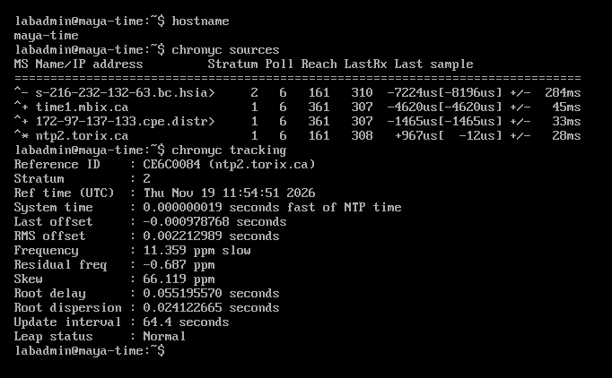
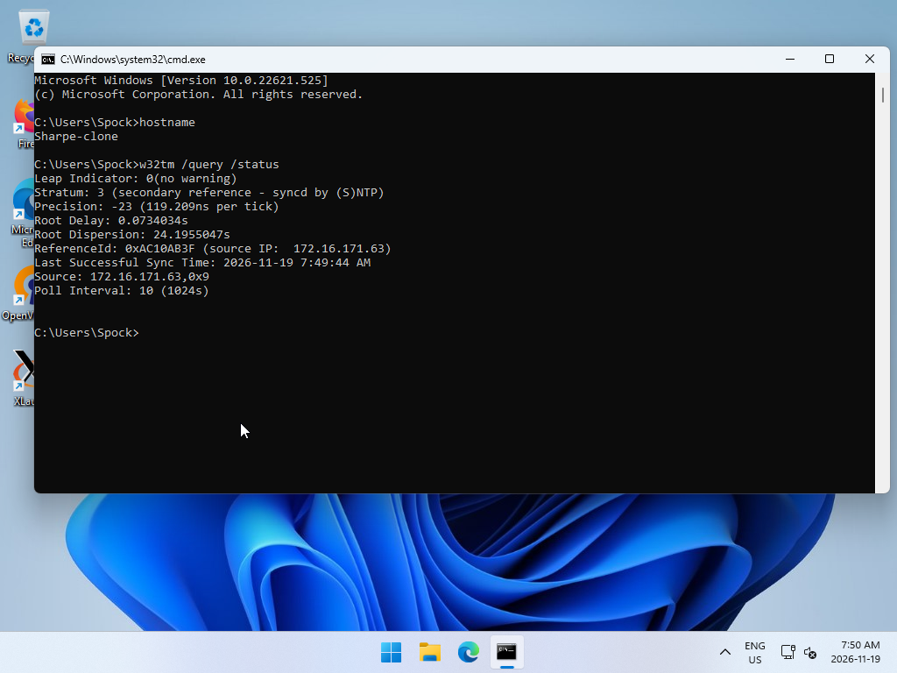
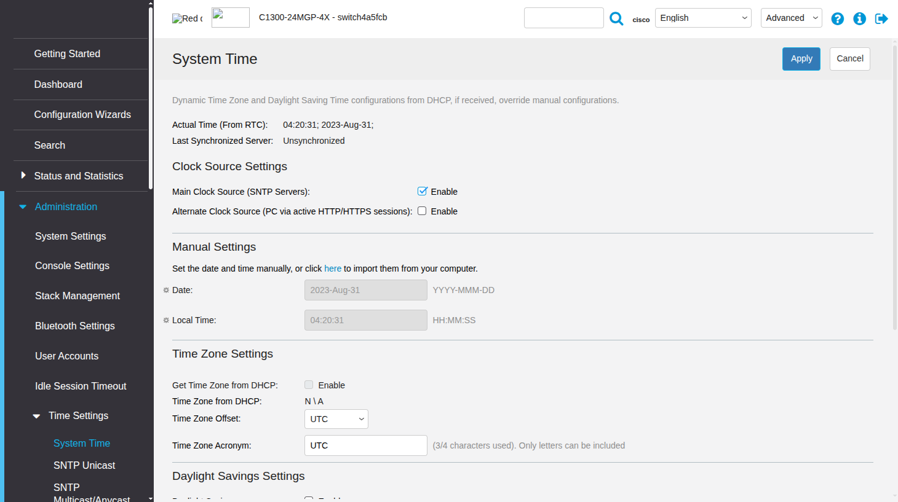
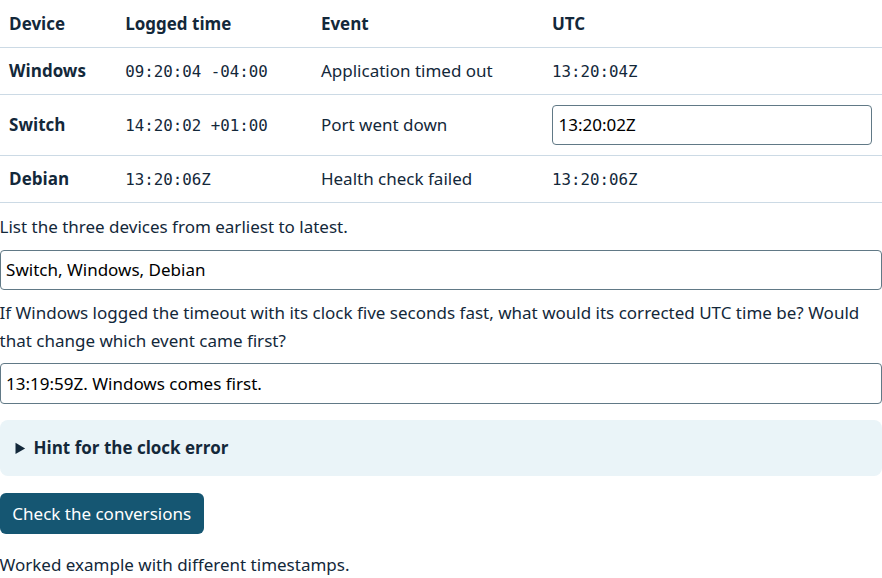

# Which happened first?

OSYS-3030 · Network Time Protocol on Debian, Windows, and the Catalyst 1300 · Target 40 minutes after setup

[Download the interactive HTML lab](https://github.com/WikiSteve/networking-labs/releases/download/ntp-lab-html/index.html). Open the downloaded `index.html` in your browser to fill in and check the timeline.

> **Before you start:** Download the [NTP Lab Submission Template](https://github.com/WikiSteve/networking-labs/releases/download/ntp-lab-html/NTP-Lab-Submission-Template.pptx). Add each required screenshot directly into this file as you complete the lab, then submit the completed template for grading.

A switch, a Windows VM, and a Debian VM each write a line to a log, a record of something that happened. A developer asks whether the switch port went down before the Windows application timed out.

```
09:00:04 -04:00  Windows  Application timed out
14:00:02 +01:00  Switch   Port went down
13:00:06Z        Debian   Health check failed
```

Make a quick prediction. You’ll come back to these three practice records at the end. First, you’ll learn how to set a time zone, give devices a shared time source, and read the resulting timestamps.

- Use your own Debian and Windows VMs and your assigned classroom Catalyst 1300. Have admin access to both VMs and use the switch management account provided for your bench.
- Start with `chrony` installed on Debian. Chrony is the software Debian will use to keep and share time. Your instructor supplies the lab subnet, the switch management address and the bench network connection. Write down the IP of Debian’s interface facing the lab. Use that same IP throughout.
- The switch and Windows must be able to reach Debian on the lab network. Debian also needs access to an approved upstream time source. A VM network shared only between VMs does not put a physical switch on that network.
- Use the assigned bench switch and its settings. For the Windows exercise, use a lab VM you are allowed to change. A domain-joined VM can do the measurement path without changing domain time settings.

If Debian is missing chrony, run `sudo apt update` and then `sudo apt install chrony` during setup.

On Debian, run `ip -br addr` for a short list of network addresses. Find the IPv4 address on the bench subnet your instructor gave you. If you see two network adapters, ask which one faces the bench before using its IP. Use the IP without the slash and number when you enter the time server address.

## 1. Read the clocks · 7 min

**NTP** is the Network Time Protocol. A device asks a time server for timing information and uses the replies to adjust its clock. NTP commonly uses UDP port 123. **UTC**, Coordinated Universal Time, is the common time reference. A **time zone** controls how the same instant appears locally.

**Work through this one.** At `09:00:04 -04:00`, the local clock is four hours behind UTC. Add four hours to get `13:00:04Z`. A trailing `Z` means UTC. During daylight saving time, Atlantic time is three hours behind UTC, so `09:00:04 -03:00` is `12:00:04Z`. For a positive offset, subtract instead. `15:30:00 +01:00` is `14:30:00Z`. Use the offset written in the log.

1.  In Debian, set the VM’s time zone to UTC and check its current display.

    ```
    sudo timedatectl set-timezone UTC
    date
    ```

2.  In Windows, open **Settings → Time & language → Date & time**. If necessary, turn off **Set time zone automatically**, then choose **(UTC-04:00) Atlantic Time (Canada)**. Check the taskbar clock. Keep **Set time automatically** as it is. The time-zone picker shows the standard offset in its label, even during daylight saving time.

3.  Compare the displays. The minutes should be close if both clocks are already reasonably accurate. Expect a four-hour difference in Atlantic standard time and a three-hour difference during daylight saving time. Check the zone and daylight-saving settings if the difference is unexpected.

## 2. Serve time on Debian · 9 min

**Who asks whom?** A standalone Windows VM and the switch ask Debian for time. Debian asks an upstream time server. Upstream means the server Debian gets its time from.

Debian will do two jobs. It gets time from an upstream server, then answers time requests from your lab clients. **Stratum** counts levels away from a reference clock. A stratum 1 server gets time directly from a reference such as a GPS receiver. A server synchronized to a stratum 1 server is stratum 2. If Debian selects a stratum 2 upstream, Debian reports stratum 3. Stratum alone does not tell you the size of a clock’s error.

1.  Open the chrony configuration. Keep the upstream lines already set up for class.

    ```
    sudo nano /etc/chrony/chrony.conf
    ```

2.  Add one line at the end to allow the bench subnet. Replace the example subnet with the one your instructor gave you. It must include the Windows lab IP and the switch management IP. In nano, press `Ctrl+O`, `Enter`, then `Ctrl+X`.

    ```
    allow 192.168.1.0/24
    ```

3.  Restart chrony. Then check its time source and its own clock status. Read the output before collecting your first capture.

    ```
    sudo systemctl restart chrony
    hostname
    chronyc sources
    chronyc tracking
    ```

In `sources`, find the row beginning `^*`. Read that row’s **Stratum** value. In `tracking`, find Debian’s **Stratum** and confirm that **Leap status** says **Normal**. Check that Debian’s stratum is one higher than the selected source. If there is no selected source, wait a minute and check again. [If Debian still has no source](#no-source), resolve that before moving on.

## **Screenshot 1: Debian Time Source and Stratum**

**Requirement:** In one screenshot, show your Debian hostname, the selected upstream row in `chronyc sources`, and Debian’s own stratum and normal leap status in `chronyc tracking`.



Debian pilot. The selected row starts with ^\*. Tracking shows stratum 2 and normal leap status. Your server and stratum may differ.

Open a real service log. Look for **Selected source** to see when chrony chose an upstream server. The journal shows service messages with UTC timestamps. Press `q` if a pager opens.

```
sudo journalctl --utc -u chrony
```

## 3. Set switch time · 6 min

The Catalyst 1300 uses SNTP, the Simple Network Time Protocol, to get time from a server. SNTP uses the same time exchanges as NTP with simpler clock handling. It can use Debian as that server. This gives switch events such as a disconnected link timestamps you can compare with the VM logs.

1.  Sign into the assigned switch in your browser. Note its current clock source and time zone so you can restore them if asked. Set the display mode to **Advanced**, then open **Administration → Time Settings → System Time**. Enable **Main Clock Source (SNTP Servers)**. Leave **Alternate Clock Source (PC via active HTTP/HTTPS sessions)** off so the switch uses network time.
2.  On the same page, under **Time Zone Settings**, set **Time Zone Offset** to **UTC** and enter `UTC` for **Time Zone Acronym**. Leave **Daylight Savings** disabled for UTC. If the switch gets its time zone from DHCP, ask your instructor before changing that setting. Select **Apply**.
3.  Under **Time Settings → SNTP Unicast**, enable **SNTP Client Unicast**. Keep the source interface on **Auto** unless your instructor specifies an interface. Select **Apply**.
4.  Select **Add** (the **+** above the server table). Choose **By IP address** and **Version 4**, enter Debian’s lab IP, enable **Poll Interval**, and select **Apply**.

Switch polling may take several minutes. Continue to the Windows step while the switch waits for its next poll.

## 4. Check Windows · 7 min

First, find what Windows currently uses. From Start, search for **Command Prompt** and select **Run as administrator**. Run these two commands:

```
hostname
w32tm /query /status
```

Look for **Source** and **Last Successful Sync Time**. On a VM joined to Active Directory (AD), Windows normally gets time through a domain controller. One designated controller at the top of that hierarchy gets time from a trusted source. A Samba AD controller needs a configured time service to provide time to Windows. A clock that drifts far enough can break domain sign-in.

Open **Control Panel → Clock and Region → Date and Time**. If the **Internet Time** tab is available on your standalone VM, use the first path. Domain-joined VMs normally lack that tab. Use the second path if you joined the VM in the Samba lab.

1.  **Standalone VM:** In Windows, open **Control Panel → Clock and Region → Date and Time → Internet Time → Change settings**. Enable **Synchronize with an Internet time server**. Type Debian’s lab IP into **Server** and select **Update now**. After a successful update, select **OK**, repeat the status command and look for Debian’s IP as **Source**. Windows may append a setting such as `,0x9` to that address. Also look for a recent **Last Successful Sync Time**.
2.  **Domain-joined VM:** Keep the current domain time settings. Test whether Debian replies by measuring the difference between the two clocks. Standalone VM users can run this same test if they want to see the offset.

```
w32tm /stripchart /computer:192.168.1.10 /samples:5
```

Replace `192.168.1.10` with Debian’s lab IP. `/samples:5` makes the test stop after five tries. An offset is the difference between the two clocks. Rows with offsets in seconds mean Debian replied. Error rows mean Windows did not get a usable reply. This measurement leaves the Windows clock and its selected source as they were.

## **Screenshot 2: Windows Time Check**

**Requirement:** Show the Windows hostname and either the successful sync status naming Debian as the source (standalone), or the Debian address and successful offset samples from the test (domain-joined).



Standalone Windows pilot. Windows shows the Debian IP as Source and reports stratum 3. A domain-joined capture will show successful offset samples instead.

### Compare local time and UTC in a real Windows event

To see why UTC is useful in Windows logs, open **Event Viewer → Windows Logs → System**. Open a recent event. **General** shows its local time. Select **Details → XML View** and look for `TimeCreated`. The `SystemTime` value ends in `Z`.

## 5. Verify the switch · 3 min

In **SNTP Unicast**, find the row with Debian’s IP. Look for **Up** and a **Last Response** timestamp. Return to **System Time**. **Last Synchronized Server** should show Debian’s IP and stratum. Check that the displayed time is in UTC and close to the time from `date` on Debian. If you see another server or an empty field, start the [incident timeline](#incident) while it waits and return here. Sign back into the switch if the session timed out. If it still has no result, use [Switch didn’t select Debian](#switch-help).

## **Screenshot 3: Catalyst Last Synchronized Server**

**Requirement:** Show the assigned switch’s **System Time** page with **Last Synchronized Server** displaying Debian’s lab IP and the server stratum, with the UTC time-zone setting visible.



Cisco’s Catalyst 1300 emulator shows where to look. Its sample is unsynchronized. Your classroom switch should show Debian’s IP and the server stratum.

Open **Status and Statistics → View Log → RAM Memory** to see where the switch records events. Look at the **Log Time** for a recent event. On a bench where your instructor asks for UTC logs, **Administration → System Log → Log Settings** has **Log Timestamp Timezone** and **Show Timezone** controls. Keep the management cable connected.

<a id="incident"></a>

## 6. Rebuild the timeline · 8 min

You just saw where each system records events. These three practice records give everyone the same incident to analyze. You can finish this section while the switch is waiting. All clocks in this first pass are synchronized. Convert the times to UTC, then put the records in order. The Windows conversion is started for you.

| Device  | Logged time       | Event                 | UTC                  |
|---------|-------------------|-----------------------|----------------------|
| Windows | `09:00:04 -04:00` | Application timed out | `13:00:04Z`          |
| Switch  | `14:00:02 +01:00` | Port went down        | Fill in the UTC time |
| Debian  | `13:00:06Z`       | Health check failed   | `13:00:06Z`          |

List the three devices from earliest to latest.

If Windows logged the timeout with its clock five seconds fast, what would its corrected UTC time be? Would that change which event came first?

### Hint for the clock error

A fast clock records a time later than the event really happened. Subtract five seconds from the Windows UTC time, then compare all three times again.

## **Screenshot 4: Incident Timeline in UTC**

**Requirement:** Show all three UTC times, the device order from earliest to latest, and your answer to the five-second clock error question. Capture the completed table and your answers. If working from Markdown, make the same table and answers in a text editor and capture that window.



Worked example with different timestamps. Use the practice records above for your own screenshot.

Time order helps narrow the investigation. A switch event and a Windows timeout close together are a reason to check whether that Windows traffic actually crossed the affected port.

## Troubleshooting

<a id="no-source"></a>

### Debian has no selected time source

Wait a minute after the restart and run `chronyc sources` again. If no row has `^*`, confirm Debian has its upstream network connection and the approved source is reachable. Use the journal to see whether the service started. The server needs usable upstream time before clients can trust its replies.

### Windows shows Local CMOS Clock or no replies

Local CMOS Clock alone does not prove a successful network sync. Check Debian’s actual address and the `allow` subnet. If Windows is joined to a domain, its normal source is through AD. The reply test verifies the lab endpoint without changing that hierarchy. If every test times out after Debian is synchronized, run `sudo chronyc clients` on Debian to check for client requests. Ask the instructor to check the bench path and UDP 123 if Windows is missing. If Windows instead names a hypervisor time provider, tell the instructor.

<a id="switch-help"></a>

### Switch didn’t select Debian

Confirm Debian has a selected source and serves your switch’s subnet. Check the switch peer address, its poll setting and whether the management VLAN can reach Debian’s lab NIC. On Debian, `sudo chronyc clients` can show whether a request arrived. Cisco documents a 1,024-second polling interval. An empty result may mean the switch has yet to poll. If another server is already selected, show the instructor. Cisco prefers the reachable peer with the lowest stratum. Apply time settings only on your assigned switch.

### Instructor bench preflight

Before students start, make sure both VMs and the switch management interface share a reachable lab segment. One workable pattern is a Debian lab-facing NIC on the physical bench and a separate NAT NIC for upstream access. Keep the physical switch on the isolated bench so its default public peers do not compete. Check which host adapter is bridged, that the bench permits UDP 123, and that Debian selects a real upstream. Test one switch’s initial poll on the classroom firmware. The 40-minute target assumes VMs, network addressing, chrony and switch access are ready.

### References

- [IETF NTP protocol specification](https://www.rfc-editor.org/rfc/rfc5905.html)
- [Chrony server configuration](https://chrony-project.org/doc/latest/chrony.conf.html)
- [Microsoft Windows Time Service and the AD hierarchy](https://learn.microsoft.com/en-us/windows-server/networking/windows-time-service/how-the-windows-time-service-works)
- [Cisco Catalyst 1300 administration guide](https://www.cisco.com/c/en/us/td/docs/switches/campus-lan-switches-access/Catalyst-1200-and-1300-Switches/Administration-Guide/catalyst-1300-admin-guide/administration.html)
- [Cisco SNTP polling reference](https://www.cisco.com/c/en/us/td/docs/switches/campus-lan-switches-access/Catalyst-1200-and-1300-Switches/cli/C1300-cli/clock-commands.html)

## Submit

Submit the completed PowerPoint with the four numbered captures and your name. Before you leave, follow your instructor’s direction for restoring shared switch settings.
