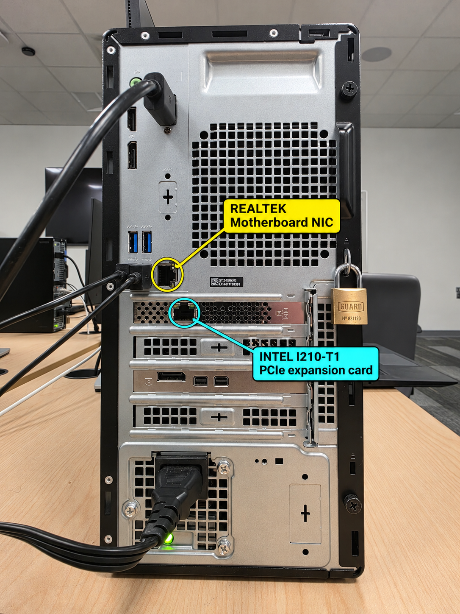
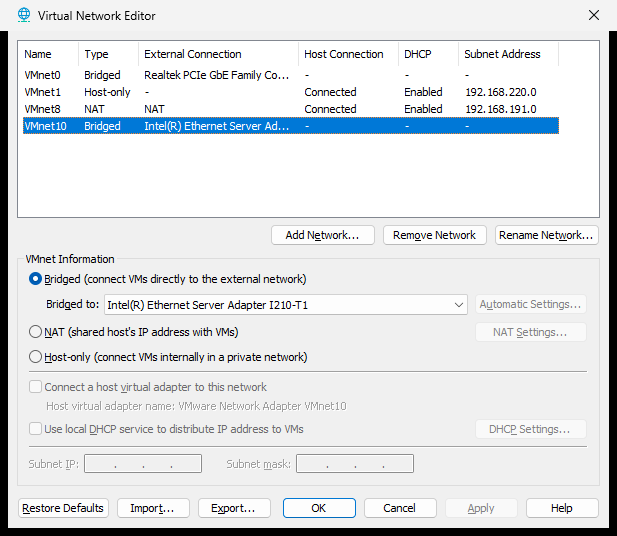
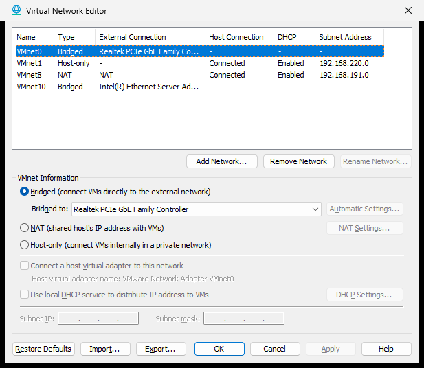
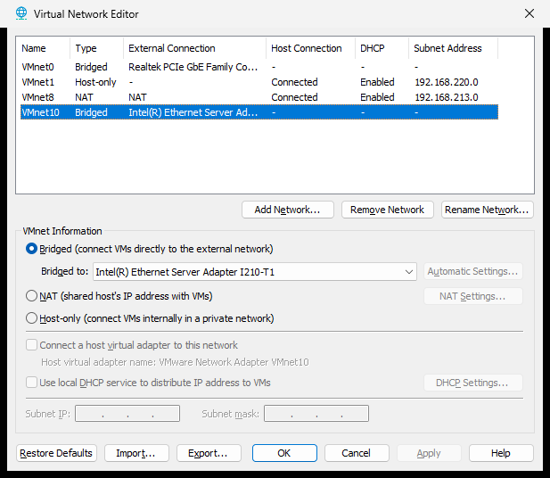
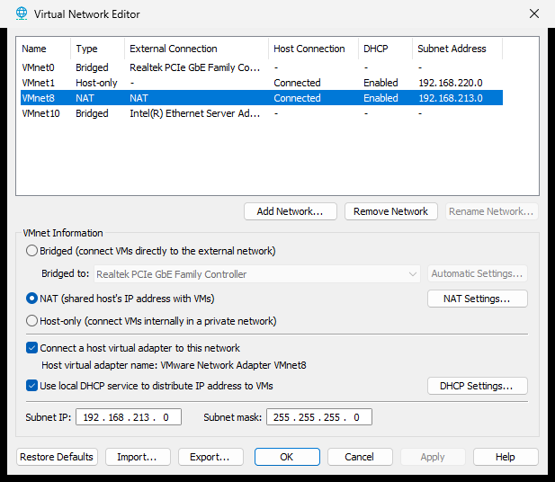
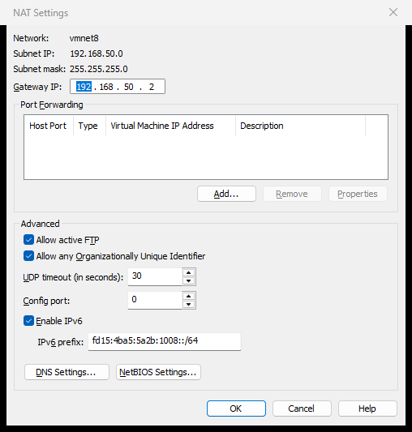
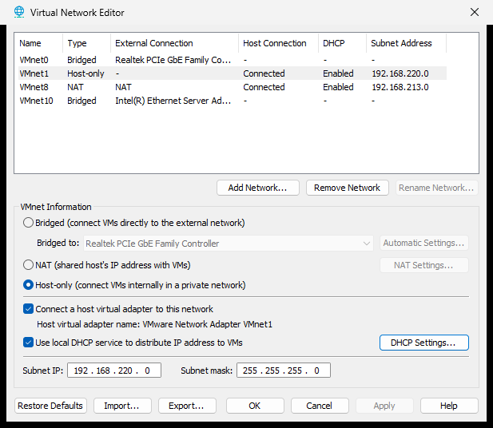
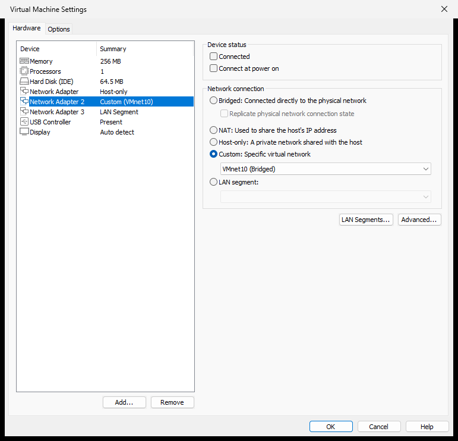

# Verify the VMware networks

[← Before you start](./01-before-you-start.md) · [Lab overview](./README.md) · [Verify the Minion uplink →](./03-verify-minion-uplink.md)

## Identify the two physical jacks

1. On the Router PC, press **Windows + R**, enter `ncpa.cpl`, and press **Enter**. This opens **Network Connections**. Identify the Realtek motherboard Ethernet adapter and the Intel I210-T1 expansion-card adapter by model. Windows names such as **Ethernet 2** can vary. Switch to **Details** view if a model name is cut off.
2. Trace the upstream cable to the Realtek jack. If it is on Intel, move it to Realtek. Open the Realtek adapter's **Status → Details** and look for an IPv4 address and IPv4 default gateway. The addresses can vary.
3. Check that Intel shows **Network cable unplugged**. If connected, trace and unplug the cable from the Intel jack. Keep the bench unplugged until [Step 3](./04-enable-lan-addressing.md).

Yellow identifies the Realtek motherboard jack for the upstream lab network. Blue identifies the Intel expansion-card jack for the isolated bench.

## Verify the bench bridges

Open **Edit → Virtual Network Editor** on the Router PC. Select **VMnet10** and confirm **Bridged** with **Intel I210-T1** in **Bridged to**. Select **VMnet0** and confirm **Bridged** to the Realtek adapter. If either mapping differs or shows **Automatic**, stop and ask your instructor to correct it. Then select **VMnet10** again for Screenshot 1.

VMware passes Ethernet frames between the Student Router LAN and the Intel bench port. The switch then forwards frames between the two bench access ports. VMnet8 uses NAT for the separate portal uplink.

Router PC hardware cross-check. VMnet0 is bridged to the Realtek upstream adapter.

Partner PC worked check. VMnet10 is bridged to the Intel I210-T1 bench adapter.

Partner PC hardware cross-check. VMnet0 is bridged to the Realtek upstream adapter.

## **Screenshot 1: Prove the dedicated bridge**

**Requirement:** Show VMware’s Virtual Network Editor with **VMnet10** selected and **Intel I210-T1** visible in **Bridged to**.

## Enable IPv6 on VMnet8

1. In **Virtual Network Editor**, click **Change Settings** to unlock controls. Choose **Yes** if Windows displays a User Account Control prompt.
2. Select **VMnet8**. Check that it uses **NAT** and **Use local DHCP service to distribute IP address to VMs** is checked. The Bridge needs this DHCP service for its upstream IPv4 address. If clear, check it and click **Apply**.
3. Click **NAT Settings** and find **Enable IPv6** under **Advanced**. If it is already checked, click **Cancel** to close that dialog. If it is unchecked, check it, keep the existing IPv6 prefix, then click **OK** and **Apply** in the editor.

Worked example from the corrected bench: VMnet8 is selected, NAT is in use, and the local DHCP service is checked. With VMnet8 selected, open NAT Settings.

Enable IPv6 is checked for VMnet8. The example subnet and prefix can differ from the ones on your PC.

## Set up VMnet1 for LuCI

The Student Router's management address is fixed at `192.168.220.2/24`. Set up the Windows end of this link on the same subnet.

1. Select **VMnet1** in **Virtual Network Editor**. Check **Host-only**, **Connect a host virtual adapter to this network**, **Subnet IP** `192.168.220.0` and **Subnet mask** `255.255.255.0`. If anything differs, use **Change Settings** if needed, correct VMnet1, and click **Apply**. Leave VMware's DHCP settings alone.
2. Close the editor. In Windows **Network Connections**, open **Status → Details** for **VMware Network Adapter VMnet1**. Look for address `192.168.220.1` with mask `255.255.255.0`.
3. If the Windows adapter is missing, recheck **Connect a host virtual adapter to this network** and click **Apply**. If its address still differs, open the Windows adapter's **Properties → Internet Protocol Version 4 (TCP/IPv4) → Properties**. Set the address and mask above, with the gateway and DNS fields blank.

VMnet1 on the lab bench. The orange box marks the Subnet IP field to edit if your subnet differs.

## Verify the two VMs' adapters

Open **VM → Settings** for both VMs. Shut down a VM before changing its adapter mapping. If the **Minion-WAN** segment is missing, use **LAN Segments** to create it once.

| VM | Adapter | Setting |
|---|---|---|
| Minion Bridge | 1 | **NAT** through VMnet8 |
| Minion Bridge | 2 | **LAN Segment → Minion-WAN** |
| OpenWrt Student Router | 1 | **Host-only** through VMnet1 |
| OpenWrt Student Router | 2 | **Custom: VMnet10**. Leave **Connected** and **Connect at power on** clear. |
| OpenWrt Student Router | 3 | **LAN Segment → Minion-WAN**, the same segment used by Minion Bridge |

Keep **Connect at power on** checked for the NAT, host-only and both LAN segment adapters. Leave the Student Router off and the Intel cable unplugged for the Bridge-only test.

[VMware Virtual Network Editor reference](https://knowledge.broadcom.com/external/article?legacyId=1018697)

Worked lab settings. Network Adapter 2 uses Custom: VMnet10. Leave Connected and Connect at power on clear until Step 3.

[← Before you start](./01-before-you-start.md) · [Lab overview](./README.md) · [Verify the Minion uplink →](./03-verify-minion-uplink.md)
