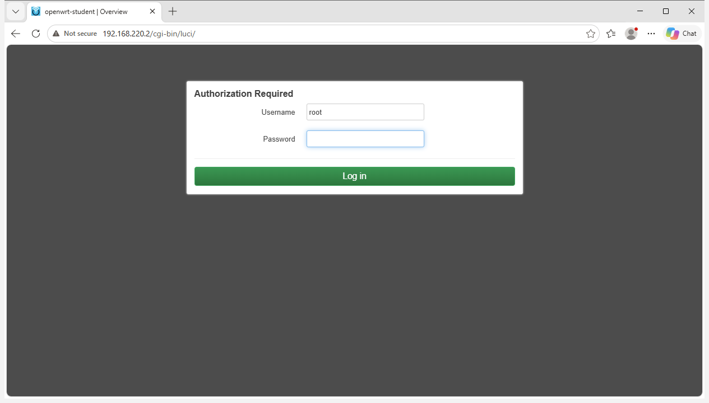
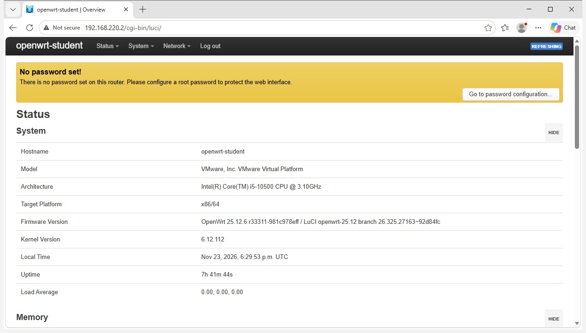
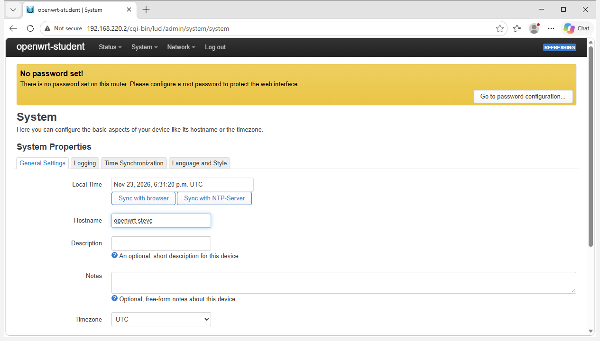
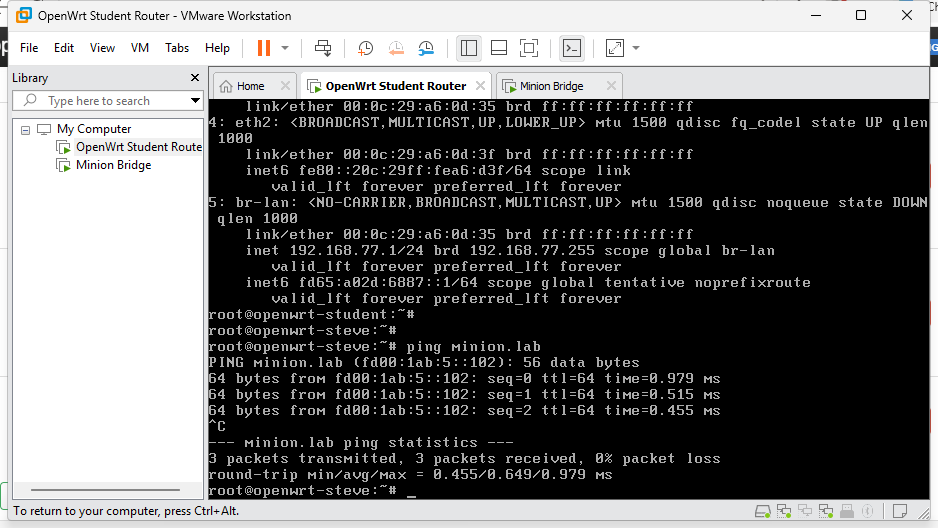
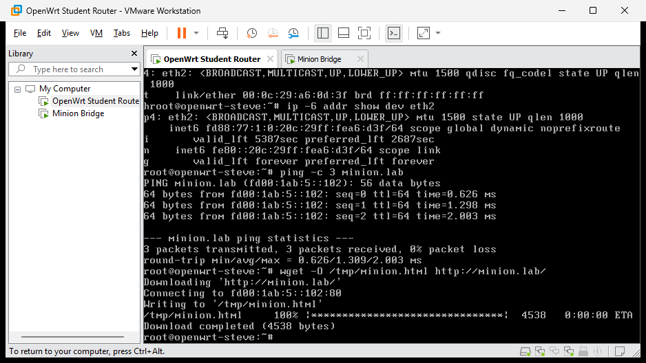
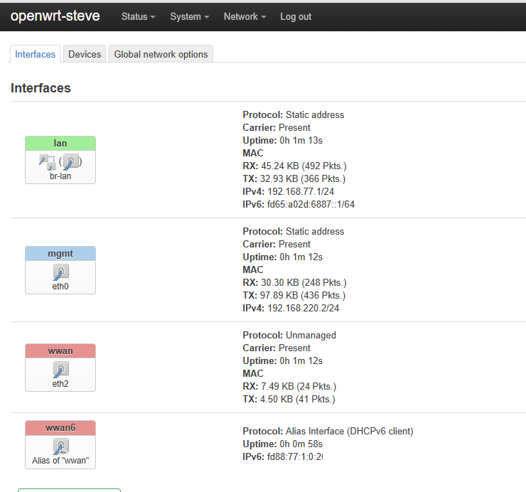

# Verify the Minion uplink

[← Verify the VMware networks](./02-verify-vmware-networks.md) · [Lab overview](./README.md) · [Give clients their LAN settings →](./04-enable-lan-addressing.md)

## What Minion Bridge does

Minion Bridge gets an IPv4 address from VMware NAT on **Adapter 1**. On **Adapter 2**, it sends IPv6 Router Advertisements to the Student Router over the private **Minion-WAN** segment. The Student Router learns an address in `fd88:77:1::/64` and answers DNS requests for `minion.lab` with the Bridge's private portal address, `fd00:1ab:5::102`. The Bridge accepts portal requests over IPv6 and opens a separate IPv4 connection to the upstream portal relay.

## Test Minion Bridge on its own

1. Select **Minion Bridge** in VMware Workstation, power it on, and wait for its OpenWrt console. If **OpenWrt Student Router** is already running, shut it down before the Bridge-only test.
2. In **VM → Settings**, confirm the Bridge's **Network Adapter** is connected to **NAT**. Confirm its **Network Adapter 2** and the Student Router's **Network Adapter 3** both use **Minion-WAN** and have **Connect at power on** checked.
3. Click inside the Bridge console and press **Enter** if needed. Look for the `root@Minion-Bridge` prompt. If a fresh Bridge asks you to log in, enter `root` and leave its password field empty. After your instructor has configured the relay, run this one line.

   ```sh
   http_proxy='http://[fd00:1ab:5::102]' wget -O /dev/null http://minion.lab/
   ```

   - `http_proxy` sends this one download through the Bridge’s own relay. The brackets enclose its IPv6 address. The Bridge test uses the address directly because the Student Router's DNS service is still off.
   - `wget` downloads the page. The capital `-O` sends the output to `/dev/null` so you can repeat the check without saving a file.
   - `http://minion.lab/` names the site to the upstream server. Requesting the numeric address as the website can return **404 Not Found**.

Look for **Download completed**. If the test fails, leave the Student Router off and the Intel bench cable unplugged. Use the [Minion Bridge checks](./09-troubleshooting.md#diagnose-a-failed-check-on-minion-bridge) to check its upstream IPv4 address and portal relay before continuing.

## Open LuCI and name your Student Router

1. Leave Minion Bridge running. If VMware is holding the mouse and keyboard, press **Ctrl+Alt**. Power on **OpenWrt Student Router** and open [http://192.168.220.2/](http://192.168.220.2/) in the Router PC's browser.
   If LuCI does not open after the VM boots, check that **Adapter 1** is connected to **VMnet1**, then [verify the Windows VMnet1 address](./02-verify-vmware-networks.md#set-up-vmnet1-for-luci) so the browser and router are on the same management network.
2. Sign in as `root`. Leave the password empty on a fresh Student Router. If you already set one, use it.
3. Click **Go to password configuration…** in the yellow **No password set!** banner, or open **System → Administration**. Enter your new password in **Password** and **Confirmation** and click **Save**. Use the new password if LuCI asks you to sign in again.
4. Open **System → System → General Settings**. Set **Hostname** to `openwrt-firstname`, using your own lowercase first name, for example `openwrt-steve`. Click **Save & Apply** and look for the name at the top of LuCI.



First login in LuCI. The username is root and the password box is empty.



After the first login, the yellow banner has a button that opens the password settings.



General Settings with openwrt-steve entered in the Hostname field. Scroll down to Save & Apply.

## Check the Student Router's WAN

1. Open **Network → Interfaces**. Find **wwan** on device **eth2**, then check **wwan6** for an IPv6 address in `fd88:77:1::/64`. If you see only an address starting with `fe80:`, it is link-local and the advertised prefix is still missing. Use the [Minion Bridge checks](./09-troubleshooting.md#diagnose-a-failed-check-on-minion-bridge) to verify the private segment and the service that sends the prefix.
2. Open the Student Router console in VMware. Press **Enter** if needed and, if prompted, sign in as `root` with the password you set. Run:

   ```sh
   ping minion.lab
   ```

   Look for `minion.lab` to resolve to `fd00:1ab:5::102` and for replies from that address. Stop with **Ctrl+C** after replies appear. If the name gives a bad-address error or the ping gets no replies, use the [Minion Bridge checks](./09-troubleshooting.md#diagnose-a-failed-check-on-minion-bridge) to compare the name with the numeric IPv6 address and narrow down DNS or routing.
3. In the same console, run:

   ```sh
   wget -O /tmp/minion.html http://minion.lab/
   ```

   Look for **Download completed**. The capital `-O` saves the page to a temporary filename you can reuse. This checks the relay and its upstream connection together. If ping works but the download fails, use the [Minion Bridge checks](./09-troubleshooting.md#diagnose-a-failed-check-on-minion-bridge) to see whether the relay is listening and can reach the upstream portal.
4. Optional. Run `head /tmp/minion.html` to print the first lines. Look for the page title **Minion | Networking labs**. Press **Ctrl+Alt** when you need to return to Windows.

Keep the Intel cable unplugged and the Student Router's LAN services off until both the ping and portal download succeed.



Worked console check on openwrt-steve. Minion replied to all three pings.


Worked console check using the default filename index.html. Your command uses a temporary filename. Look for Download completed and the Minion | Networking labs title.



Use this console example to diagnose the WAN. Screenshot 2 uses the LuCI Interfaces view below.

## **Screenshot 2: Prove the Minion uplink**

**Requirement:** Show LuCI **Network → Interfaces** with **wwan** on **eth2** and **wwan6** with an address in `fd88:77:1::/64`.



[← Verify the VMware networks](./02-verify-vmware-networks.md) · [Lab overview](./README.md) · [Give clients their LAN settings →](./04-enable-lan-addressing.md)
