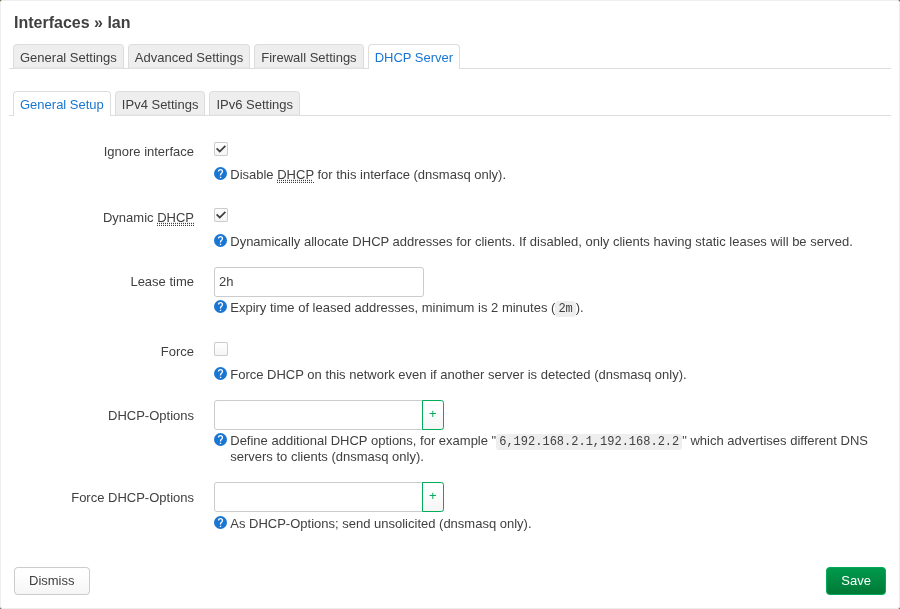
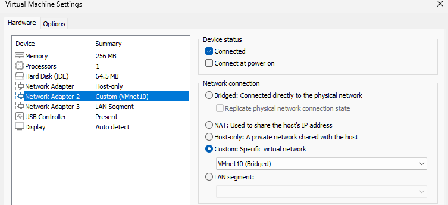
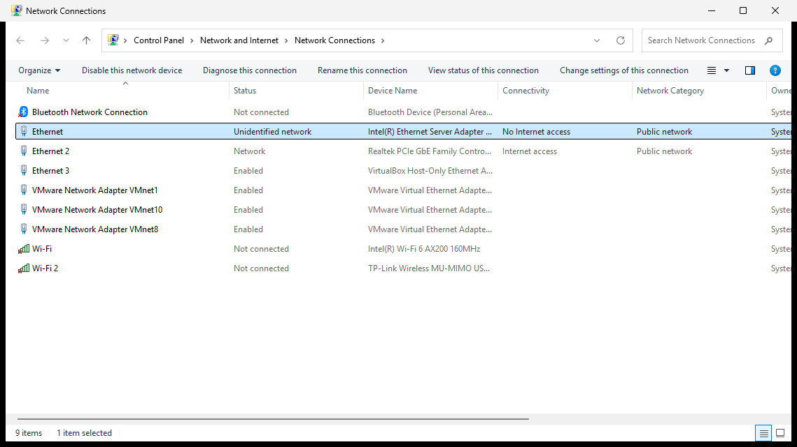
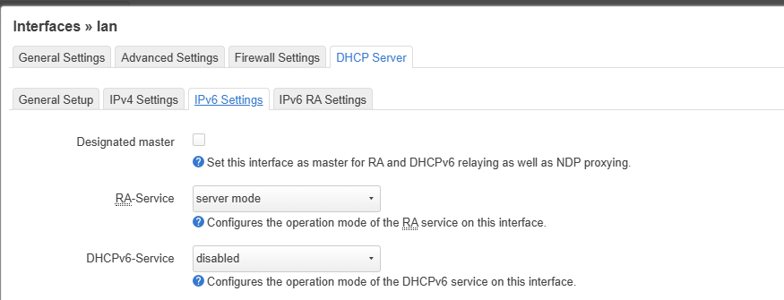
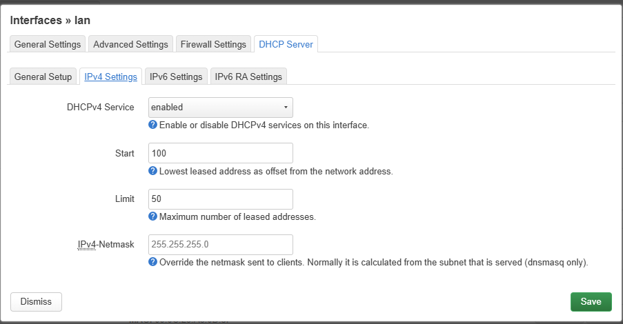

# Give clients their LAN settings

[← Verify the Minion uplink](./03-verify-minion-uplink.md) · [Lab overview](./README.md) · [Verify the wired Partner PC →](./05-verify-wired-partner.md)

## Check the LAN with Adapter 2 disconnected

1. Open LuCI at `http://192.168.220.2/` and go to **Network → Interfaces**. Find **lan** on **br-lan** with IPv4 address `192.168.77.1/24`. This will be the partner's gateway. The separate **mgmt** interface is the connection your browser is using.
2. Click **Edit** on the **lan** row. In the upper tab row choose **DHCP Server**, then choose **General Setup** in the lower row. Confirm **Ignore interface** is checked and **Force** is clear.
3. Go to the lower **IPv6 Settings** tab and confirm **RA-Service** is disabled. If you changed a setting, click the green **Save** in the dialog, then the blue **Save & Apply** on the Interfaces page. Otherwise click **Dismiss**. Leave Adapter 2 disconnected for this check.



Actual LuCI starting screen. The DHCP Server and General Setup tabs are selected. Ignore interface is checked before the isolation test.

## Connect the two physical PCs

Using one PC and a Windows VM? Follow the [one-workstation setup](#one-workstation-with-a-windows-partner-vm) instead.

1. Check every port on the isolated switch, including uplink ports. It must have no links to the upstream network, another switch, or another pair.
2. Keep the Realtek upstream cable in place. Connect the Router PC's **Intel I210-T1** jack to one access port. Connect the Partner PC's dedicated Ethernet jack to another access port in the same VLAN. The two switch port link lights should come on. If the isolated switch serves multiple VLANs, check **VLAN Management → Port VLAN Membership** in its web GUI. [Catalyst 1300 VLAN reference](https://www.cisco.com/c/en/us/td/docs/switches/campus-lan-switches-access/Catalyst-1200-and-1300-Switches/Administration-Guide/catalyst-1300-admin-guide/vlan-management.html)
3. On the Router PC, open **VM → Settings → Network Adapter 2** for the Student Router. Verify **Custom: VMnet10**, check **Connected** and click **OK**. Leave **Connect at power on** clear.
4. On the Partner PC, press **Windows + R**, enter `ncpa.cpl` and press **Enter**. Identify the Ethernet adapter on the bench cable and record its Windows name. An unidentified network is expected before the router gives it a lease.
5. Right-click the adapter and choose **Properties → Internet Protocol Version 4 (TCP/IPv4) → Properties**. Select **Obtain an IP address automatically** and **Obtain DNS server address automatically**. Click **OK**. Keep **Internet Protocol Version 6 (TCP/IPv6)** enabled.

Continue to the [before-DHCP check](#check-the-bench-before-starting-dhcp-and-ra).



Worked lab wiring check. Adapter 2 uses Custom: VMnet10, with Connected checked. The screenshot shows the VM dialog.



Partner Windows Network Connections with the Intel adapter selected.

## One workstation with a Windows partner VM

1. Keep Minion Bridge running and leave the Realtek upstream cable in place. The only cable on the isolated switch must connect to the Router PC's Intel jack.
2. In the Student Router's **VM → Settings → Network Adapter 2**, verify **Custom: VMnet10** and check **Connected**. In [Virtual Network Editor](./02-verify-vmware-networks.md#verify-the-bench-bridges), confirm VMnet10 still maps to **Intel I210-T1**.
3. Open your separate Windows partner VM. In **VM → Settings**, set its only connected network adapter to **Custom: VMnet10** and start Windows. Open `ncpa.cpl` inside the VM, record the connected Ethernet adapter's name, set IPv4 and DNS to automatic, and leave IPv6 enabled.

Continue to the [before-DHCP check](#check-the-bench-before-starting-dhcp-and-ra) and run all Partner PC commands inside the Windows VM. VMware may forward traffic directly between the two VMs. This setup checks partner addressing and portal access. The two-PC bench also shows traffic crossing the physical switch.

## Check the bench before starting DHCP and RA

On the Partner PC or in the Windows partner VM, open **Command Prompt** and run:

```text
ipconfig /all
```

The `/all` option includes the **DHCP Server** field. Find the adapter whose name you recorded. Before the lab DHCP service starts, expect no IPv4 address or an autoconfiguration address starting with `169.254.`. An IPv6 link-local address starting with `fe80:` is normal. If this adapter already has an assigned IPv4 address, a routed IPv6 address or a default gateway, **stop** and trace the bench connections before enabling any services.

## Enable IPv4 DHCP and IPv6 Router Advertisements

1. On the Router PC, recheck **Student Router → VM → Settings → Network Adapter 2**. It must show **Custom: VMnet10**. Open **Edit → Virtual Network Editor**, select that exact VMnet, and read **Bridged to**. It must show the **Intel I210-T1** connected to the isolated switch. If it shows **Realtek**, **Automatic**, or another adapter, **leave DHCP and Router Advertisements off** and [follow the bridge checks in Step 1](./02-verify-vmware-networks.md#verify-the-bench-bridges).
2. In LuCI, open **Network → Interfaces → lan → Edit → DHCP Server → General Setup**. Clear **Ignore interface**. Keep **Dynamic DHCP** checked and the lease time at **2h**.
3. In the lower **IPv4 Settings** tab, set **DHCPv4 Service** to **enabled**, **Start** to **100**, and **Limit** to **50**. If the fields are greyed out, return to **General Setup** and clear **Ignore interface**.
4. In the lower **IPv6 Settings** tab, set **RA-Service** to **server mode**. Leave **DHCPv6-Service** and **NDP-Proxy** disabled.
5. Click the green **Save** in the dialog, then the blue **Save & Apply** on the Interfaces page. Wait for the applying overlay to close and reopen the LAN dialog to verify the saved values.

DHCPv4 gives the partner an IPv4 address from `192.168.77.100` to `192.168.77.149`. Router Advertisements give the partner the information it needs for an IPv6 address and default route to reach the Minion portal. Screenshot 3 records the saved IPv4 pool. In Step 4, you'll verify the IPv6 address and route and open the portal.



Worked lab IPv6 Settings. RA-Service is in server mode so the router can advertise an IPv6 route.


The blue Save & Apply button on the Interfaces page. Use it after closing the LAN dialog with Save.

## **Screenshot 3: Show the LAN DHCP settings**

**Requirement:** After saving and applying the configuration, reopen **lan → Edit → DHCP Server → IPv4 Settings**. Show **DHCPv4 Service** set to **enabled**, **Start** set to **100**, and **Limit** set to **50**.



[← Verify the Minion uplink](./03-verify-minion-uplink.md) · [Lab overview](./README.md) · [Verify the wired Partner PC →](./05-verify-wired-partner.md)
