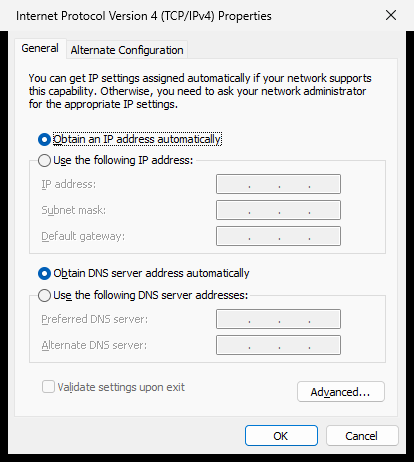
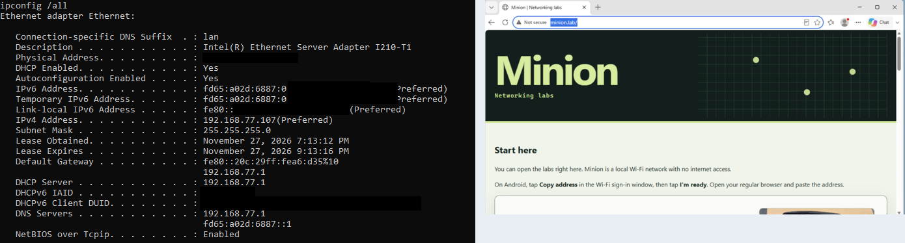
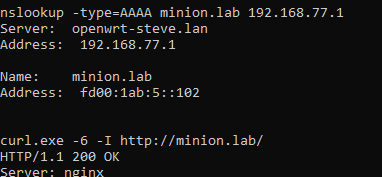

# Verify the wired Partner PC

[← Give clients their LAN settings](./04-enable-lan-addressing.md) · [Lab overview](./README.md) · [Connect both phones →](./06-connect-both-phones.md)

1. On a physical Partner PC, leave only its Intel cable to the isolated switch connected. Temporarily turn off Wi-Fi and unplug its other Ethernet cables. For the one-workstation option, confirm that the Windows partner VM has just one connected adapter, set to **Custom: VMnet10**. This tests the virtual lab connection. VMware may forward traffic on the same host, so a successful check there does not establish that traffic crossed the physical switch. Leave the Router PC’s upstream connection in place.
2. In Command Prompt, run `ipconfig /all` and find the same dedicated adapter. Expect an IPv4 address from `192.168.77.100` to `192.168.77.149`. The IPv4 default gateway and DHCP server should be `192.168.77.1`. Look for a separate IPv6 address, usually starting with `fd`, in addition to the link-local address. The IPv6 default gateway itself can start with `fe80:` because the router is on the same link. If the adapter still shows `169.254.x.x`, use the [Partner PC DHCP checks](./09-troubleshooting.md#the-partner-pc-still-has-a-169254-address) to find why it missed its IPv4 lease.
3. Open a private browser window and go to `http://minion.lab/`. If the Minion page appears, the wired web check passed. Keep the address bar visible for Screenshot 4. In this lab, OpenWrt gives Minion an IPv6 address.

- **IPv4 lease is present, but Minion will not open:** [Check IPv6 and DNS](./09-troubleshooting.md#the-partner-has-ipv4-but-minion-will-not-open) to see whether the Partner PC has a route to Minion and can resolve its name.
- **Minion opens, but the adapter details look wrong:** Isolate the intended connection again, reload the page, and recheck the adapter before taking Screenshot 4.
- **Ping says Destination port unreachable:** Keep going with the browser check. See [why a web request can succeed while ping fails](./09-troubleshooting.md#minion-opens-but-ping-reports-destination-port-unreachable), or try the [optional firewall demo](./09-troubleshooting.md#optional-firewall-demonstration) to see what changes when OpenWrt permits that ping.

Want a second way to verify IPv6 web access? Use the [optional Windows HTTP status check](#optional-windows-check--see-the-http-status) to see the response code.

To verify automatic IPv4 and DNS on a physical Partner PC, open the Intel adapter’s **Properties**, select **Internet Protocol Version 4 (TCP/IPv4)**, and click **Properties**. Both settings should say **automatically**.



Windows IPv4 Properties with automatic IP and DNS selected.

## **Screenshot 4: Prove the partner’s wired connection**

**Requirement:** Show the Partner PC’s wired adapter name, IPv4 lease, IPv6 address, default gateways and DHCP server beside the Minion portal at `http://minion.lab/`. In the slide notes, record whether Minion opened with only the wired bench connection active.



The rehearsal used a temporary host route to keep remote management connected while verifying the bench path. That route was removed. For your capture, isolate the Partner PC as described above. Restore the Partner PC connections you temporarily turned off after taking Screenshot 4.

## Optional Windows check · See the HTTP status

Windows 11 includes `curl.exe`. Run it in Command Prompt to view the web response over IPv6.

```text
curl.exe -6 -I http://minion.lab/
```

The `-6` option uses IPv6. The capital `-I` shows the response headers. Look for **200 OK**. If both curl and the browser fail after the Partner PC gets an IPv4 lease, use the [IPv6 and DNS checks](./09-troubleshooting.md#the-partner-has-ipv4-but-minion-will-not-open) to see where the web request is getting stuck.



Optional command-line example. The IPv6 web request returned 200 OK.

[← Give clients their LAN settings](./04-enable-lan-addressing.md) · [Lab overview](./README.md) · [Connect both phones →](./06-connect-both-phones.md)
