# Connect both phones

[← Verify the wired Partner PC](./05-verify-wired-partner.md) · [Lab overview](./README.md) · [Test the MAC filter and restore access →](./07-test-mac-filter.md)

Your Student Router already serves the wired LAN. Connect the physical radio to that VM so your phones can join the same LAN over Wi-Fi.

### Attach the Archer to the Student Router

Start with the Archer assigned to your bench. Your instructor prepares the adapter for this lab.

[See the VMware USB handoff in pictures](#vmware-usb-handoff-in-pictures) if the menu is unfamiliar.

1. Find the Archer T4U v3 USB adapter with the hinged antenna panel assigned to your bench. Plug it into the Router PC. If VMware says the adapter belongs to another VM, stop and ask your instructor to release it.
2. Select the **OpenWrt Student Router** tab in VMware. Open **VM → Removable Devices**. Point to the USB Wi-Fi adapter. The bench example calls it **TP-Link 802.11ac NIC**. Yours may say **TP-Link**, **Realtek**, or **USB Wireless**. If VMware lists no adapter, [check the USB connection and controller](./09-troubleshooting.md#the-archer-radio-or-wireless-menu-is-missing) so the Student Router can receive the dongle.
3. Choose **Connect (Disconnect from Host)**. If prompted, select **OpenWrt Student Router** and click **OK** to release the adapter from Windows. Reopen the adapter submenu. When it offers **Disconnect (Connect to host)**, the selected VM owns the radio. Press **Esc** to close the menu and leave it connected.

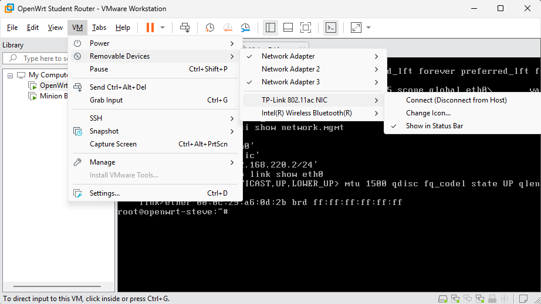

Student Router selected in VMware with VM, Removable Devices, TP-Link 802.11ac NIC and Connect visible.

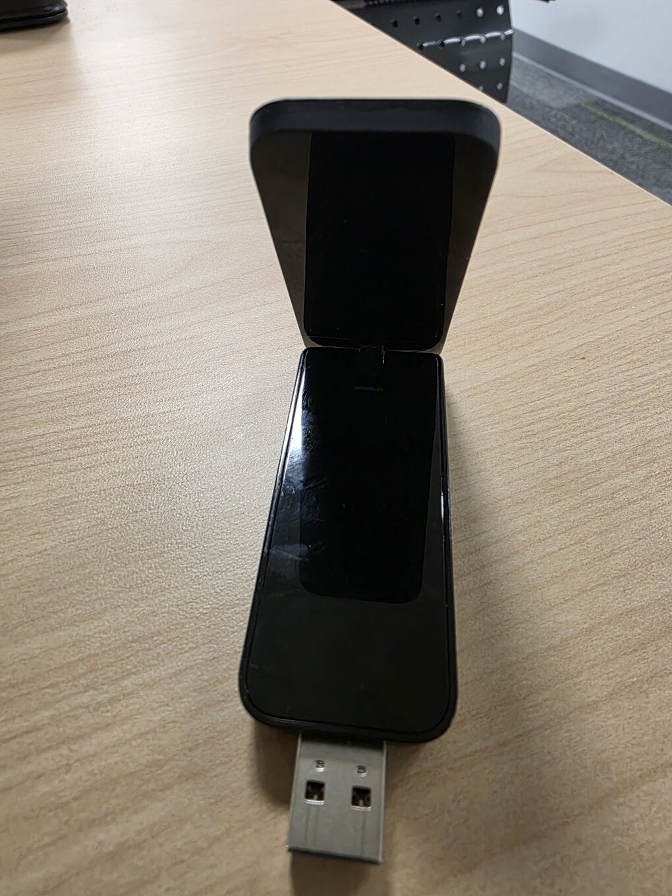

Find the TP-Link Archer T4U USB adapter with the hinged antenna panel.

### Check the radio before opening Wireless

Click in the Student Router console and look for the `root@openwrt-firstname` prompt.

1. Run `lsusb` to list USB devices. Find `2357:0115`, the USB ID for the Archer. The bus and device numbers can vary. If the ID is missing, [check the USB handoff to the Student Router](./09-troubleshooting.md#the-archer-radio-or-wireless-menu-is-missing). The ID confirms that the guest received the dongle. Continue when it appears.
2. Run `ls /sys/class/ieee80211` to list the radios registered by the Wi-Fi driver. Look for an entry such as `phy0`. If the USB ID appears and the radio list is empty, [check radio detection](./09-troubleshooting.md#the-archer-radio-or-wireless-menu-is-missing). A visible USB device still needs its driver and firmware to register a radio.
3. Once a radio appears, run `wifi config` to create its wireless settings. It may return to the prompt silently. Press **Ctrl+Alt** to release the console. In LuCI, log out, sign back in and open **Network → Wireless**. If Wireless is still missing, [check the configuration and LuCI session](./09-troubleshooting.md#the-archer-radio-or-wireless-menu-is-missing) so you can tell which part of setup is incomplete.

### Set up your team’s access point

1. In **Wireless Overview**, find the radio row, such as **radio0**. Click **Edit** on the network row beneath it. A fresh network may be called **OpenWrt**. If there is no network row, click **Add** on the radio row.
2. In the upper **Device Configuration → General Setup** tab, set **Country Code** to **CA** for this bench. Under **Operating frequency**, choose **2.4 GHz**, a width of **20 MHz**, and channel **1**, **6**, or **11** as assigned. The frequency controls appear with the physical radio attached.
3. In the lower **Interface Configuration → General Setup** tab, select **Access Point**, enter `FirstName-Wireless` as the **ESSID** using the Router PC operator’s first name, and select **lan** for **Network**. Both phones will use the same address services as the wired partner. Older practice images show `minion-team07`. Use your own name, as in `Steve-Wireless`.
4. In the lower **Wireless Security** tab, choose **WPA2-PSK** and enter a temporary passphrase of 8 to 63 characters in **Key**. Keep it handy for both phones. Click **Save**. Back on Wireless Overview, click **Enable** on your network row if needed, then **Save & Apply**. Wait for your SSID under the radio. LuCI may label its mode **Master**.

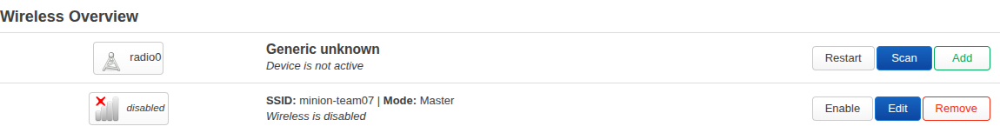

Older practice image showing the SSID minion-team07. Enter FirstName-Wireless for this lab. On a fresh router, the network may be named OpenWrt. Add is on the radio row. Edit and Enable are on the network row.

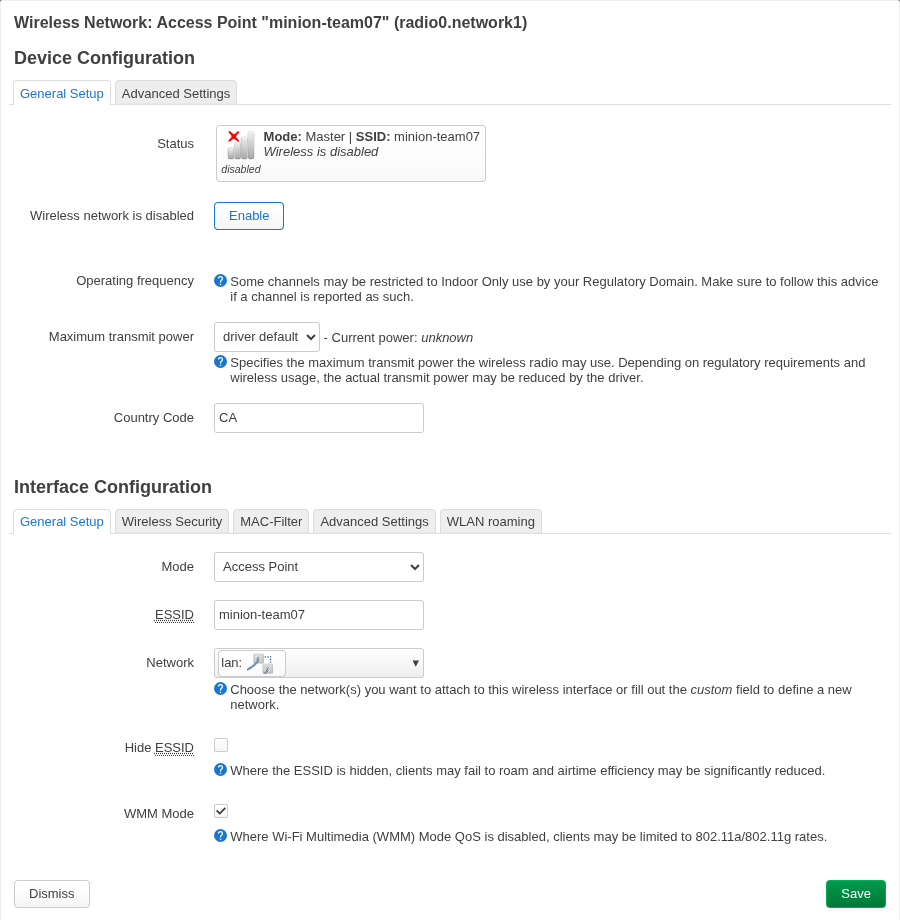

Older LuCI practice image showing minion-team07. Enter FirstName-Wireless for this lab. Country Code belongs to the device. Mode, ESSID and Network belong to the interface. The frequency controls appear with a physical radio attached.

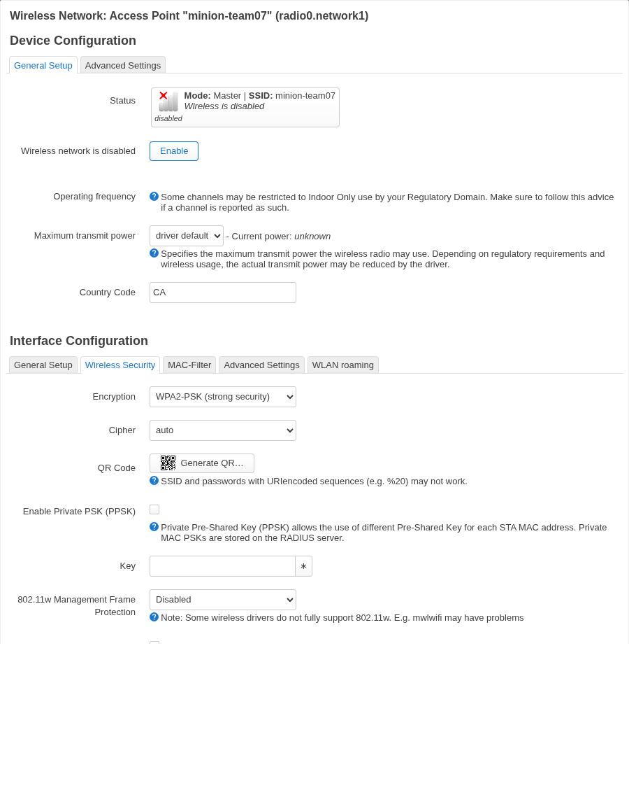

Older LuCI Wireless Security image showing minion-team07. Use your FirstName-Wireless network and set your own Key.

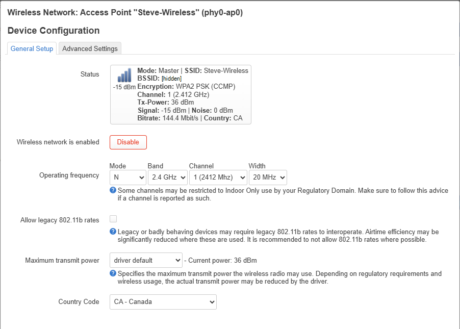

Live lab radio settings after Save & Apply. Both phones rejoined on 2.4 GHz and received an address.

### Join one phone at a time

1. On **Phone A**, open Wi-Fi settings, join your team’s SSID and enter the passphrase. If asked whether to stay connected without Internet access, choose to stay connected. Open `http://minion.lab/` in the phone’s browser.
2. On the Router PC, find the new row for your SSID in **Wireless Overview → Associated Stations**. [Match the phone’s Wi-Fi address](#find-the-wi-fi-address-your-phone-is-using) to that row so you can identify it again during the filter test. A signal reading confirms radio association. To check IP assignment separately, look under **Status → Overview** or **Network → DHCP → Leases**.
3. Repeat on **Phone B**. Watch for its separate row under the same SSID and open the portal on Phone B.

- **Your SSID is missing or a phone has no station row.** [Recheck the access-point settings](#set-up-your-teams-access-point). Confirm your SSID is enabled, the settings were applied and the phone has the correct passphrase.
- **Either phone has a station row, but Minion will not open.** [Check whether the phone is using Wi-Fi for Minion](./09-troubleshooting.md#phone-joined-but-minion-will-not-open). The station row confirms it joined the radio. The portal test checks the path through the Student Router.

**Using an Android VM?** You can use its mobile browser to check the portal over virtual Ethernet or NAT. To use it for Screenshot 5 or the filter test, match its Wi-Fi address to a separate station row under your Archer radio. If only one station appears under your SSID, pause the filter test until the second Wi-Fi client joins.

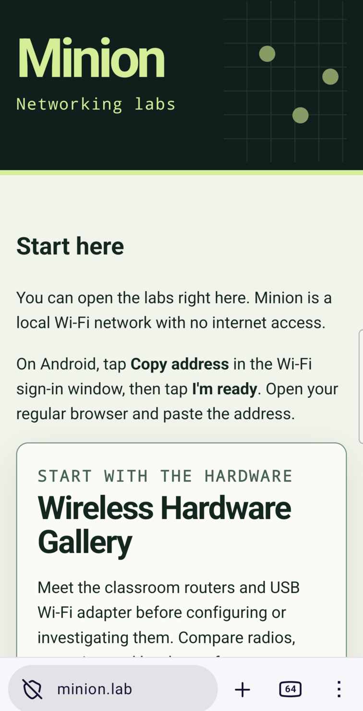

Worked lab capture. Phone B opened Minion at minion.lab while joined to Steve-Wireless.

### Find the Wi-Fi address your phone is using

- **iPhone.** Open **Settings → Wi-Fi**, tap **ⓘ** beside your team SSID and read **Wi-Fi Address**. If **Private Wi-Fi Address** offers modes, select **Fixed** for your team SSID to keep a private address stable during the test. After changing it, reconnect, read the address again and match it to LuCI. [Apple’s Wi-Fi privacy guide](https://support.apple.com/en-us/102509)
- **Android.** On a Pixel, open **Settings → Network & internet → Internet**. On a Galaxy, open **Settings → Connections → Wi-Fi**. Tap the gear beside your team SSID, open its details and find the address. Keep the per-network randomized MAC mode. If you change the setting, reconnect, read the address again and match it to LuCI. [Android’s network settings guide](https://support.google.com/android/answer/9654714)

If your menus differ, join one phone at a time and watch which row appears. The filter uses the address LuCI sees on your team’s SSID.

## **Screenshot 5: Show two phones on your access point**

**Requirement:** Show two **Associated Stations** rows under your own SSID. Label them **Phone A** and **Phone B**. Show only the last two pairs of digits of each phone’s Wi-Fi MAC address, and use those same endings in Screenshot 6.

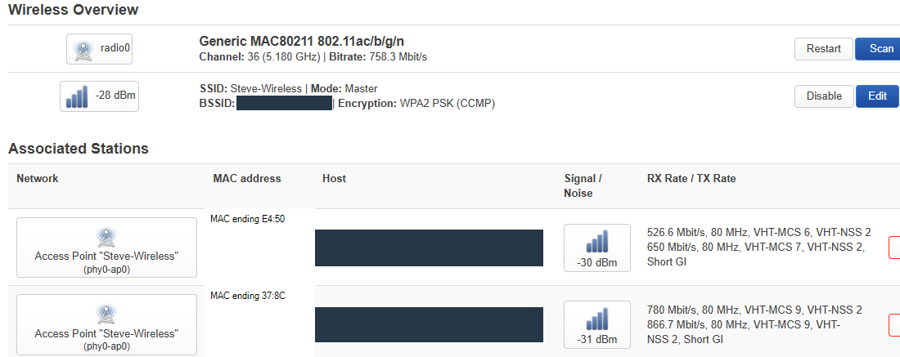

In the example, Phone A ends in `E4:50` and Phone B ends in `37:8C` under `Steve-Wireless`. The hostnames, host addresses and AP MAC are covered. Use your own phones’ endings. Verify the portal separately on each phone.

## VMware USB handoff in pictures

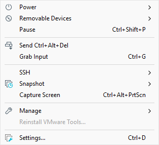

Worked VMware menu capture. Point to Removable Devices.

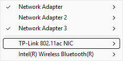

Worked VMware submenu capture. Point to TP-Link 802.11ac NIC.

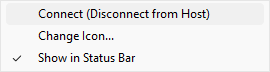

Before attachment. Choose Connect (Disconnect from Host).

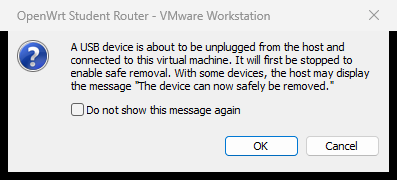

VMware warns that Windows will release the USB adapter. Click OK.

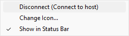

After attachment. The submenu now offers Disconnect (Connect to host). Leave the adapter connected.

[← Verify the wired Partner PC](./05-verify-wired-partner.md) · [Lab overview](./README.md) · [Test the MAC filter and restore access →](./07-test-mac-filter.md)
