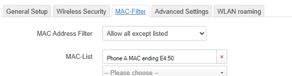
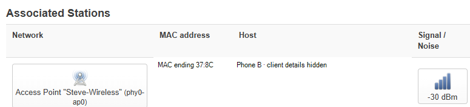
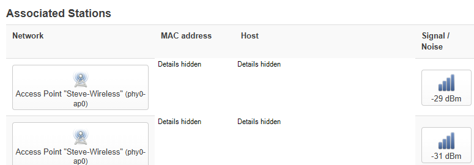
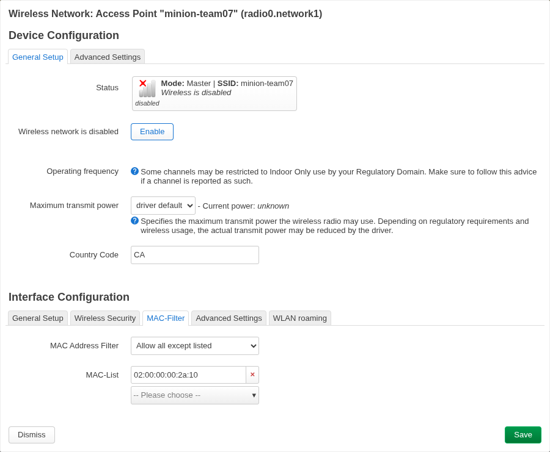

# Test the MAC filter and restore access

[← Connect both phones](./06-connect-both-phones.md) · [Lab overview](./README.md) · [Submit and clean up →](./08-submit-and-clean-up.md)

1. Open **Network → Wireless** and find both station rows from Screenshot 5 under your SSID. Choose one of those phones to block. Read its current full Wi-Fi MAC address from **Associated Stations**. Phones can use a randomized address for a network, so use the address OpenWrt actually sees.
   Use the full address in LuCI and mask it in the submitted slide. Older practice images use `minion-team07` and a sample address. Apply the rule on your own `FirstName-Wireless` network.
2. In **Network → Wireless**, click **Edit** beside your SSID. Open **Interface Configuration → MAC-Filter** and choose **Allow all except listed**. In **MAC-List**, select the phone’s full address or enter it and press **Enter**. Confirm it appears in the list. Click **Save**, then **Save & Apply**.
3. Applying the rule may briefly interrupt both phones. Wait for your AP row to return. On both phones, try to reconnect using their saved network profiles. Keep the profiles and check that each phone is using the address you recorded. The blocked phone may report a generic join error or ask for the password again. In **Associated Stations**, check that the blocked phone has no row and the other phone is associated again. If a phone uses a different randomized address, record the new address before repeating the filter test. Open Minion again on the phone that can join.
4. On the Router PC, open a second browser window at `http://192.168.220.2`. Put **MAC-Filter** in one window and **Associated Stations** in the other so both results are visible while the rule is active.

## **Screenshot 6: Demonstrate the MAC filter**

**Requirement:** With the rule active, show the deny-list entry and the other phone’s **Associated Stations** row. Put two LuCI browser windows side by side if needed. Show only the last two address pairs, matching Screenshot 5. In the slide notes, record the blocked phone’s reconnect attempt and what happened after you restored access.

In the example, Phone A (ending `E4:50`) could not reconnect using its saved network and had no station row. Phone B (ending `37:8C`) briefly disconnected, then rejoined `Steve-Wireless` and reached the router while the rule was active.

### Restore the blocked phone

In **MAC-Filter**, set **MAC Address Filter** back to **Disable**, then **Save** and **Save & Apply**. Reconnect the blocked phone. Verify that it appears in **Associated Stations** and can open the portal again. Keep WPA2 enabled.

In the restoration example, Phone B kept `37:8C`. Phone A rejoined the same saved network, received a LAN address and reached the router. Android used a new randomized address ending in `58:33`. Screenshots 5 and 6 still show its earlier `E4:50` address. Before repeating the test, read the current address in **Associated Stations**.

### Optional local checks

- Open **Status → Realtime Graphs → Bandwidth**, choose the LAN, reload the portal and watch for a traffic change.
- Compare **Associated Stations** with the DHCP leases. Which records a radio association, and which records an IPv4 assignment?
- In **Network → DHCP**, find where you could add a fixed lease. Explain how assigning a predictable address differs from blocking a station with the MAC filter.

## Another worked MAC-filter example

Older LuCI practice image showing minion-team07 and a sample address. Apply the policy to your FirstName-Wireless network using the phone address you recorded.

[← Connect both phones](./06-connect-both-phones.md) · [Lab overview](./README.md) · [Submit and clean up →](./08-submit-and-clean-up.md)
