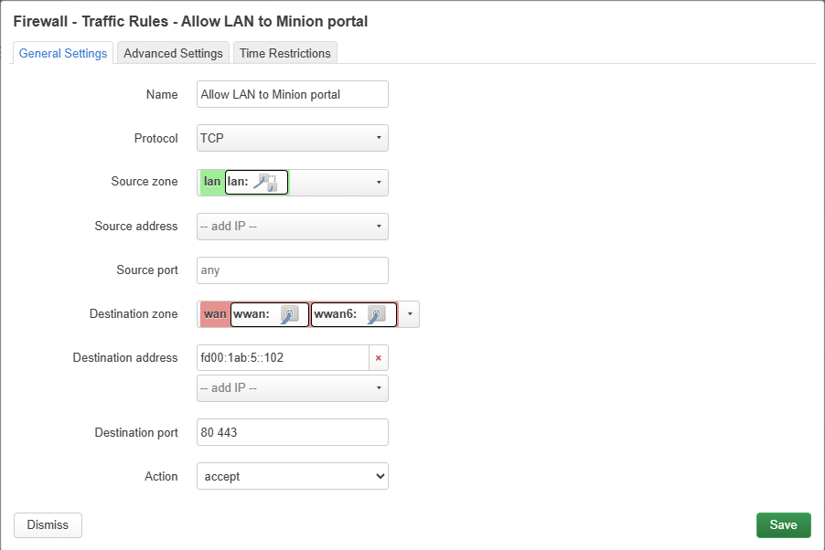
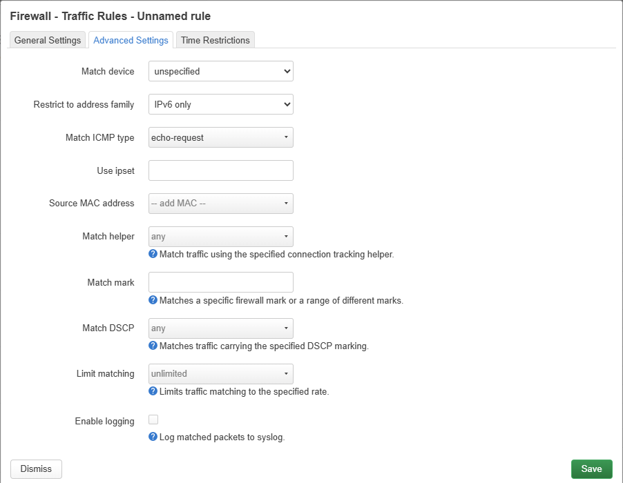
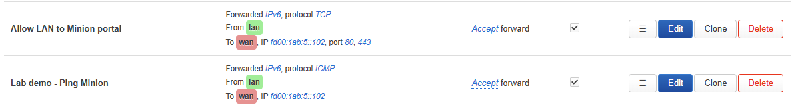

# Troubleshooting

[← Submit and clean up](./08-submit-and-clean-up.md) · [Lab overview](./README.md)

## The Partner PC still has a 169.254 address

Windows gives itself a `169.254.x.x` address while it waits for DHCP. Check that both bench cables land on access ports in the same VLAN, that Adapter 2 is connected to the Intel bridge, and that the saved LAN DHCP settings match [Step 3](./04-enable-lan-addressing.md). The switch’s link lights only confirm the physical links are up.

## Minion opens but ping reports Destination port unreachable

If Minion opens on the Partner PC with only its bench Ethernet active, you can finish [Screenshot 4](./05-verify-wired-partner.md#screenshot-4-prove-the-partners-wired-connection). DNS, ping and the browser test answer different questions. DNS looks up the address, ping sends an echo request, and the browser asks for the page.

### Optional firewall demonstration

The prebuilt router’s **Allow LAN to Minion portal** rule permits TCP ports 80 and 443 to `fd00:1ab:5::102`. Ping uses ICMPv6 Echo, which has no TCP or UDP port. On the prepared bench, Windows can report **Destination port unreachable** for the rejected echo even though HTTP returns **200 OK**.

1. On the Partner PC, run `ping -6 minion.lab` and read the result.
2. In LuCI, open **Network → Firewall → Traffic Rules**. Find **Allow LAN to Minion portal** and click **Edit**. On **General Settings**, read **Protocol** for the kind of packet, **Source zone** and **Destination zone** for its direction, and **Destination address** for the host. **Destination port** and **Action** tell you which TCP ports the rule accepts. Click **Dismiss** after reading the rule.
3. Add a separate rule called **Lab demo - Ping Minion**. Select only **ICMP** for **Protocol**, **lan** for **Source zone**, **wan** for **Destination zone**, `fd00:1ab:5::102` for **Destination address**, and **accept** for **Action**. Under **Advanced Settings**, set **Restrict to address family** to **IPv6 only** and select **echo-request** for **Match ICMP type**. Save and apply.
4. Repeat `ping -6 minion.lab` and reload the portal in a private browser window. Then delete the demo rule, save and apply, and repeat the ping. Compare the three results.

On the tested bench, Windows could ping over its upstream Realtek connection. Using only the Intel bench path gave **Destination port unreachable** before adding the rule, replies while it was active, and **Destination port unreachable** after deleting it. HTTP returned **200 OK** in all three states.

## Phone joined but Minion will not open

If the phone appears in **Associated Stations**, it has joined the access point. Keep the phone connected to the lab Wi-Fi if it warns that the network has no internet. Temporarily turn off mobile data, open `http://minion.lab/` in your browser, and turn mobile data back on after the test.

[← Submit and clean up](./08-submit-and-clean-up.md) · [Lab overview](./README.md)
