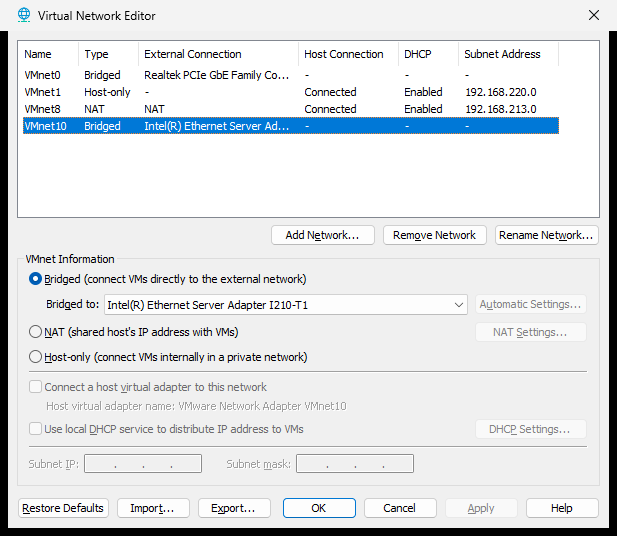
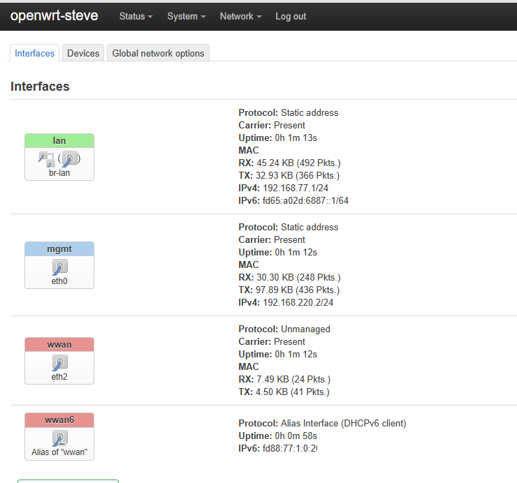
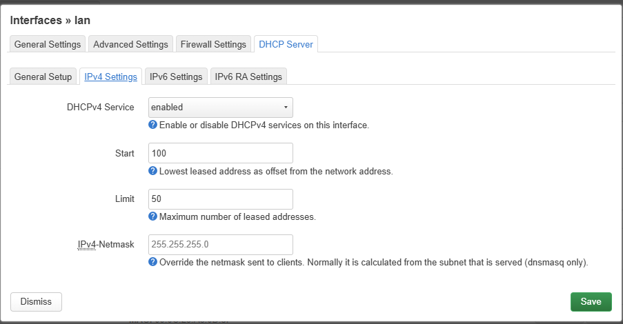
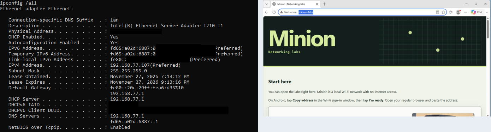
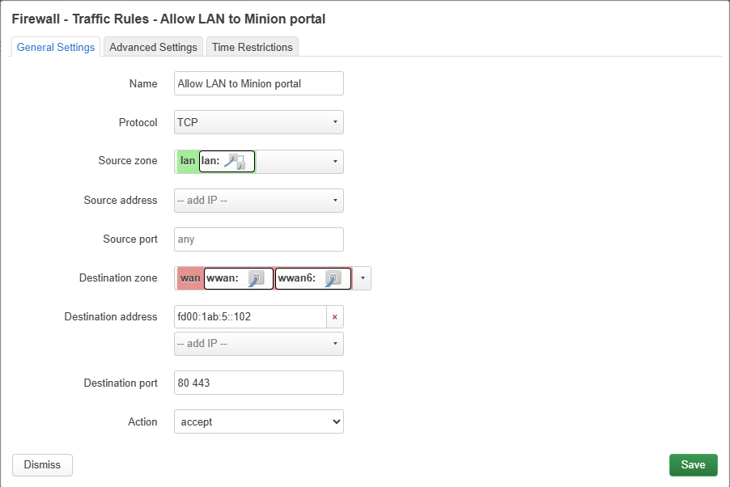
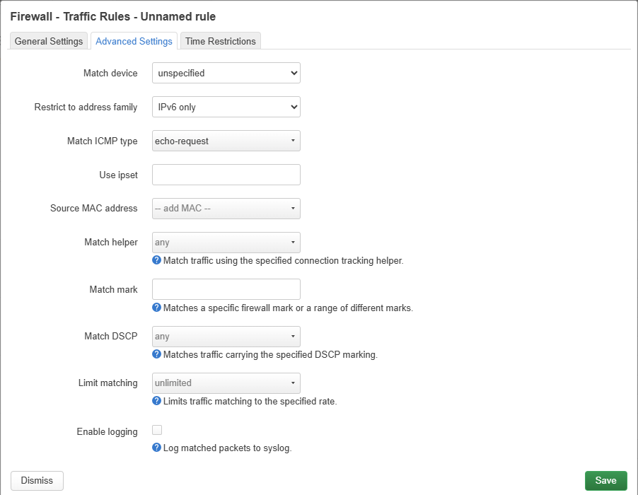
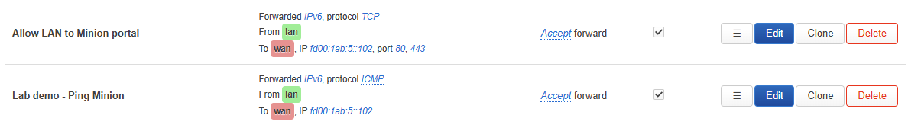
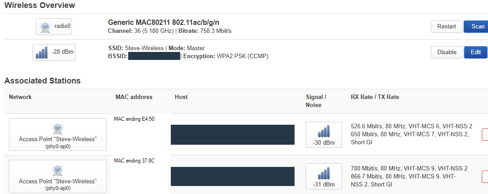
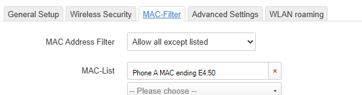
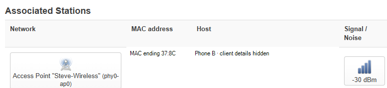

# OpenWrt Student Router Lab

Work in pairs to build a wired and wireless LAN with OpenWrt. Verify a Windows client’s IPv4 lease and IPv6 path to the lab portal. Then connect two phones to your own access point and test a temporary MAC address filter.

[Download the interactive HTML walkthrough](https://github.com/WikiSteve/networking-labs/releases/download/openwrt-student-router-lab/index.html) · [Download the two prebuilt VMs](https://github.com/WikiSteve/networking-labs/releases/download/openwrt-student-router-lab/OpenWrt-Student-VMs.zip)

> **Before you start:** Download the [OpenWrt Student Router Lab submission template](https://github.com/WikiSteve/networking-labs/releases/download/openwrt-student-router-lab/OpenWrt-Student-Router-Lab-Submission-Template.pptx). Add each required screenshot to the matching slide as you complete the lab, then submit one completed template per pair.

Open the downloaded `index.html` in a browser to see the interactive version.

## Before you start

- Use two Windows PCs, VMware Workstation on the **Router PC**, an isolated switch, two Ethernet cables, two phones and a supported USB Wi-Fi adapter. The worked example uses a Catalyst 1300 and a TP-Link Archer T4U v3.
- The Router PC uses one Ethernet adapter for its upstream lab network and a separate Intel I210-T1 for your isolated bench. The **Partner PC** uses its own dedicated Ethernet connection to the bench.
- The Minion Bridge VM needs a portal server reachable on the upstream network. Have your instructor follow the [portal setup guide](PORTAL-SETUP.md) before starting. Once that setup is complete, lab clients browse to `http://minion.lab/`.
- Extract the VM ZIP. In VMware Workstation, choose **File → Open** for `Minion Bridge/Minion-Bridge.vmx` and `OpenWrt Student/OpenWrt-Student.vmx`. Keep the virtual disks with their corresponding VM files. Leave both VMs powered off while you check their settings.

## 1. Verify the VMware networks

Open **Edit → Virtual Network Editor** on the Router PC. Select each network and check the settings below.

| Network | Expected setting | Purpose |
|---|---|---|
| VMnet0 | Bridged to the Realtek adapter | Upstream physical connection |
| VMnet10 | Bridged to Intel I210-T1 | Isolated physical bench |
| VMnet8 | NAT with local DHCP and IPv6 enabled | Minion Bridge upstream |
| VMnet1 | Host-only with a host virtual adapter on `192.168.220.0/24` | Router PC access to LuCI |

Read the full **Bridged to** field for VMnet10. If it says **Automatic**, **Realtek**, or a different device, stop and ask your instructor to correct the mapping before connecting the bench. In **Network Connections**, open **Status → Details** on the Windows VMnet1 adapter and check for `192.168.220.1` with mask `255.255.255.0`. The router itself uses `192.168.220.2`.

### Screenshot 1 · Prove the dedicated bridge

**Requirement:** Show VMware’s Virtual Network Editor with **VMnet10** selected and **Intel I210-T1** visible in **Bridged to**.



Open **VM → Settings** for both VMs and check each adapter. Create the **Minion-WAN** LAN segment once if it is missing.

| VM | Adapter | Setting |
|---|---|---|
| Minion Bridge | 1 | NAT |
| Minion Bridge | 2 | LAN Segment **Minion-WAN** |
| OpenWrt Student Router | 1 | Host-only VMnet1 |
| OpenWrt Student Router | 2 | Custom VMnet10. Leave it disconnected and clear **Connect at power on**. |
| OpenWrt Student Router | 3 | LAN Segment **Minion-WAN** |

Keep **Connect at power on** checked for the NAT, host-only and LAN segment adapters.

## 2. Verify the Minion uplink

1. Start **Minion Bridge** and wait for its console prompt. After your instructor has configured the relay, test it from that VM.

   ```sh
   http_proxy='http://[fd00:1ab:5::102]' wget -O /dev/null http://minion.lab/
   ```

   The `http_proxy` setting directs this one download through the Bridge’s relay. The brackets enclose its IPv6 address. The capital `-O` sends output to `/dev/null` so you can repeat the check without saving a file. Expect the download to complete. If it fails, recheck the Bridge’s NAT adapter and VMnet8 DHCP.

2. Leave the Bridge running and start **OpenWrt Student Router**. Open `http://192.168.220.2/` on the Router PC. The prebuilt image uses `root` with an empty password for the first LuCI login. Set your router password using LuCI’s password prompt. In **System → System**, save a hostname such as `openwrt-steve` using your own first name.
3. Open **Network → Interfaces**. Find **wwan** on device **eth2** and look for **wwan6** with an IPv6 address in `fd88:77:1::/64`.
4. In the Student Router console, run the checks below. Stop ping with **Ctrl+C** after you see replies. The second command saves the page to a named temporary file so you can repeat it.

   ```sh
   ping minion.lab
   wget -O /tmp/minion.html http://minion.lab/
   ```

   Wait for both checks to pass before turning on LAN services. If there is only a link-local address starting with `fe80:`, recheck the shared **Minion-WAN** segment and that the Bridge is running.

### Screenshot 2 · Prove the Minion uplink

**Requirement:** Show LuCI **Network → Interfaces** with **wwan** on **eth2** and **wwan6** with an address in `fd88:77:1::/64`.



## 3. Give clients their LAN settings

1. With Student Router Adapter 2 still disconnected, open **Network → Interfaces → lan → Edit → DHCP Server**. Under **General Setup**, confirm **Ignore interface** is checked and **Force** is clear. Under **IPv6 Settings**, confirm **RA-Service** is disabled. Apply any change before continuing.
2. Your bench switch should have only the two bench cables. Connect the Router PC’s Intel jack to one access port and the Partner PC to another access port on the same VLAN. On your Router PC, open **VM → Settings → Network Adapter 2**, verify **Custom: VMnet10**, then select **Connected**. Leave **Connect at power on** clear.
3. On the Partner PC, open **Network Connections** and identify the Ethernet adapter on the bench cable. Under its **Properties → Internet Protocol Version 4 (TCP/IPv4) → Properties**, select **Obtain an IP address automatically** and **Obtain DNS server address automatically**. Keep IPv6 enabled. Run:

   ```text
   ipconfig /all
   ```

   Find the dedicated Ethernet adapter. Before you start the lab DHCP service, expect no lease or an address starting with `169.254.`. An IPv6 link-local address starting with `fe80:` is normal. If you see an assigned address or a default gateway on this link, ask your instructor to help trace the cables before continuing.
4. On the Router PC, recheck **Adapter 2 → Custom: VMnet10** and **VMnet10 → Intel I210-T1**. In LuCI, return to **lan → Edit → DHCP Server → General Setup**. Clear **Ignore interface**. Keep **Dynamic DHCP** checked and the lease time at **2h**.
5. Under **IPv4 Settings**, set **DHCPv4 Service** to **enabled**, **Start** to **100**, and **Limit** to **50**. Under **IPv6 Settings**, set **RA-Service** to **server mode**. Leave **DHCPv6-Service** and **NDP-Proxy** disabled. Click **Save**, then **Save & Apply**. DHCP gives clients their IPv4 configuration. Router Advertisements let clients learn their IPv6 prefix and route.

### Screenshot 3 · Show the LAN DHCP settings

**Requirement:** After saving and applying the configuration, reopen **lan → Edit → DHCP Server → IPv4 Settings**. Show **DHCPv4 Service** set to **enabled**, **Start** set to **100**, and **Limit** set to **50**.



## 4. Verify the wired Partner PC

1. Use only the isolated bench link on the Partner PC for this check. Temporarily turn off its Wi-Fi and disconnect its other Ethernet cables. Keep the Router PC’s upstream connection in place.
2. In Command Prompt, run `ipconfig /all` and find the same dedicated adapter. Expect an IPv4 address from `192.168.77.100` to `192.168.77.149`. The IPv4 default gateway and DHCP server should be `192.168.77.1`. Look for an IPv6 address in addition to its link-local address and an IPv6 default gateway.
3. Open a private browser window and go to `http://minion.lab/`. If the Minion page appears, the wired web check passed. Keep the address bar visible for Screenshot 4. In this lab, OpenWrt gives Minion an IPv6 address.

If the browser cannot resolve the name, run `nslookup minion.lab 192.168.77.1` in Command Prompt to ask OpenWrt directly. A correct answer shows that DNS works. Loading the page is the separate web check.

<details>
<summary>Optional Windows check · See the HTTP status</summary>

Windows 11 includes `curl.exe`. Run it in Command Prompt to view the web response over IPv6.

```text
curl.exe -6 -I http://minion.lab/
```

The `-6` option uses IPv6. The capital `-I` shows the response headers. Look for **200 OK**.

</details>

### Screenshot 4 · Prove the partner’s wired connection

**Requirement:** Show the Partner PC’s wired adapter name, IPv4 lease, IPv6 address, default gateways and DHCP server beside the Minion portal at `http://minion.lab/`. In the slide notes, record whether Minion opened with only the wired bench connection active.



<details>
<summary>Optional demonstration · Why HTTP can work while ping is rejected</summary>

The prebuilt router’s **Allow LAN to Minion portal** rule permits TCP ports 80 and 443 to `fd00:1ab:5::102`. Ping uses ICMPv6 Echo, which has no TCP or UDP port. On the prepared bench, Windows can report **Destination port unreachable** for the rejected echo even though HTTP returns **200 OK**.

1. On the Partner PC, run `ping -6 minion.lab` and read the result.
2. In LuCI, open **Network → Firewall → Traffic Rules**. Find **Allow LAN to Minion portal** and click **Edit**. On **General Settings**, read **Protocol** for the kind of packet, **Source zone** and **Destination zone** for its direction, and **Destination address** for the host. **Destination port** and **Action** tell you which TCP ports the rule accepts. Click **Dismiss** after reading the rule.
3. Add a separate rule called **Lab demo - Ping Minion**. Select only **ICMP** for **Protocol**, **lan** for **Source zone**, **wan** for **Destination zone**, `fd00:1ab:5::102` for **Destination address**, and **accept** for **Action**. Under **Advanced Settings**, set **Restrict to address family** to **IPv6 only** and select **echo-request** for **Match ICMP type**. Save and apply.
4. Repeat `ping -6 minion.lab` and reload the portal in a private browser window. Then delete the demo rule, save and apply, and repeat the ping. Compare the three results.

On the tested bench, Windows could ping over its upstream Realtek connection. Using only the Intel bench path gave **Destination port unreachable** before adding the rule, replies while it was active, and **Destination port unreachable** after deleting it. HTTP returned **200 OK** in all three states.







</details>

## 5. Connect both phones

1. Plug the Archer into the Router PC. Select the **OpenWrt Student Router** tab in VMware. Open **VM → Removable Devices**, point to the USB Wi-Fi adapter, then choose **Connect (Disconnect from Host)**. Accept the USB handoff if VMware prompts you. Reopen its menu and check that it now offers **Disconnect (Connect to host)**.
2. In the Student Router console, run these three commands in order. Look for USB ID `2357:0115` after the first command and a radio such as `phy0` after the second. Run the third only after the radio appears.

   ```sh
   lsusb
   ls /sys/class/ieee80211
   wifi config
   ```

   If the USB ID is missing, review VMware’s device handoff. If the ID appears and there is no radio, ask your instructor to check driver and firmware support. After `wifi config`, sign back in to LuCI and open **Network → Wireless**.
3. Edit the network row beneath your radio, or select **Add** on the radio row if there is no network. In **Device Configuration**, choose the country code for your location and the channel assigned to your bench. For a 2.4 GHz bench, use a width of **20 MHz** and channel **1**, **6**, or **11** as assigned.
4. In **Interface Configuration → General Setup**, select **Access Point**, enter `FirstName-Wireless` as the ESSID using the Router PC operator’s first name, and select **lan** for **Network**. In **Wireless Security**, choose **WPA2-PSK** and set a temporary passphrase. Save, enable the network if needed, and click **Save & Apply**.
5. Join one phone at a time. If the phone offers to stay connected without Internet access, choose to stay connected to your lab Wi-Fi. Open `http://minion.lab/` on each phone. In **Associated Stations**, match each phone to the row that appeared when it joined. A station row shows that the phone joined the radio. Opening the portal checks its network path separately.

### Screenshot 5 · Show two phones on your access point

**Requirement:** Show two **Associated Stations** rows under your own SSID. Label them **Phone A** and **Phone B**. Show only the last two pairs of digits of each phone’s Wi-Fi MAC address, and use those same endings in Screenshot 6.



## 6. Test the MAC filter and restore access

1. Choose one of the two phones to block. Read its current full Wi-Fi MAC address from **Associated Stations**. Phones can use a randomized address for a network, so use the address OpenWrt actually sees.
2. In **Network → Wireless**, click **Edit** beside your SSID. Open **Interface Configuration → MAC-Filter** and choose **Allow all except listed**. In **MAC-List**, select the phone’s full address or enter it and press **Enter**. Confirm it appears in the list. Click **Save**, then **Save & Apply**.
3. Wait for the AP to return. On both phones, try to reconnect using their saved settings. In **Associated Stations**, check that the blocked phone has no row and the other phone is associated again. If a phone uses a different randomized address, record the new address before repeating the filter test. Open Minion again on the phone that can join.

### Screenshot 6 · Demonstrate the MAC filter

**Requirement:** With the rule active, show the deny-list entry and the other phone’s **Associated Stations** row. Put two LuCI browser windows side by side if needed. Show only the last two address pairs, matching Screenshot 5. In the slide notes, record the blocked phone’s reconnect attempt and what happened after you restored access.




In **MAC-Filter**, set **MAC Address Filter** back to **Disable**, then **Save** and **Save & Apply**. Reconnect the blocked phone. Verify that it appears in **Associated Stations** and can open the portal again. Keep WPA2 enabled.

## Submit and clean up

Add both names to the template. Include the six numbered screenshots, the wired portal result, and your MAC-filter observations in the appropriate slide notes. Explain which observation shows IPv4 DHCP worked and which shows the partner reached the portal over IPv6.

Forget the temporary lab SSID on both phones. Shut down both lab VMs before disconnecting the bench cables and USB adapter. Restore the Partner PC’s normal connections.
